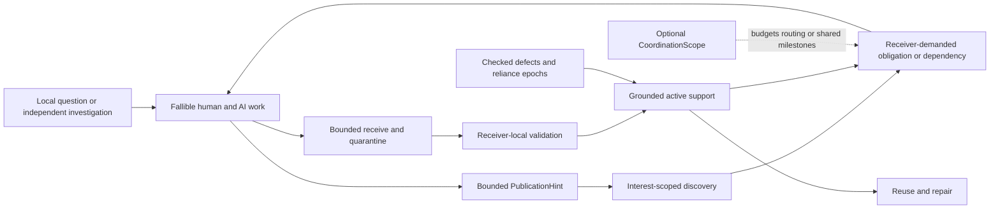

# CP-001: Trustworthy mathematical knowledge generation at very large scale

| Field | Value |
|---|---|
| Checkpoint | `CP-001` |
| Date | 2026-08-27 |
| Status | Amended by [`CP-001A`](CP-001A-autonomy-first-cooperation.md) |
| Supersedes | The priority order and first deliverable of `CP-000` |
| Preserves | Exact-context binding, local checking, typed relations, dependency impact, and fail-closed behavior from `CP-000` |
| User correction | Useful mathematical work, efficiency, reliability, and safe reuse are P0; coordination is enabling and secondary; operational identity is P0 only where required; political attribution is secondary |
| Review | Independent protocol-soundness, scale/efficiency, security, technology, and document-integrity audits |

> **Normative precedence:** this file is a historical, non-normative CP-001 record. [CP-001A](CP-001A-autonomy-first-cooperation.md) and the current [Cooperation Core](../../spec/COOPERATION-CORE-v0.md) have exclusive normative precedence wherever any wording differs. The current design uses permission-only capabilities with finite control-record allowances; nonreclaimable grant/ticket descendant-issue allowances; `RESERVED -> RUNNING -> FINALIZED` demand execution with a unique receiver-metered claim; per-component receiver-authoritative/conservative local finalization with nonauthorizing outbox intents; irreversible terminal state; and atomic reliance-state/dirty-seed/epoch publication with exact current-tree cache checks.

## 1. Revised project definition

DTMKN is:

> **A distributed mathematical research and reuse system that enables a very large, diverse population of mostly honest but fallible human and AI agents to work independently or together, produce useful results, discover and reuse earlier work, validate exact claims, and repair mistakes with high reliable yield per unit resource.**

The network's central question is no longer “how do we prove who published what?” It is:

> How can heterogeneous agents actually work out useful mathematics efficiently and reliably, while optionally learning from and coordinating with many others, without an all-knowing planner, an all-to-all broadcast fabric, a universal ontology, or blind trust in fallible outputs?

No protocol-level root goal, campaign, sponsor, or global utility is required. Agents may create local work, publish artifacts for later discovery, and reuse objects produced for unrelated purposes. Optional `CoordinationScope` objects may bundle goals, budgets, reviewers, routing hints, or stopping rules; they are non-epistemic overlays.

Exact artifact/context identity is P0 because safe reuse and deduplication require it. Operational principals are also P0 where resource accounting, cell membership, semantic-review authority, availability commitments, or failure-domain separation depends on them. Public credit, historical priority, prestige, ownership, and political governance move to P2.

## 2. Priority order

1. **End-to-end mathematical efficacy:** produce or reuse contract-valid results on nontrivial tasks within explicit resources.
2. **Reliability:** fail-closed formal validation, semantic criticism, explicit uncertainty, conflict preservation, and scoped correction.
3. **Useful knowledge integration:** exact contexts, typed obligations, reusable partial results, counterexamples, failed-method capsules, theory mappings, abstractions, and dependency-aware repair.
4. **Scale efficiency:** sharded discovery, locality, caching, exact deduplication, backpressure, and bounded speculation.
5. **Optional cooperation and coordination:** measure the marginal benefit and overhead of routing, decomposition, pull scheduling, leases, work stealing, and shared programs.
6. **Availability and graceful partition behavior.**
7. **Operational trust and admission:** authenticated cells/sessions, receiver-issued grants/tickets/reservations, permission capabilities, replay-safe budgets, revocation, and measured failure domains.
8. **Political attribution, priority history, prestige, transparency, and governance overlays.**

Proof checking is essential but is a validation adapter inside a broader research workflow. It is not the organizing principle for deciding what work should be done, what partial result is useful, or how an abstraction should be constructed.

### 2.1 Operational identity versus political attribution

Identity is split by function:

| Identity function | Priority | Why | What it cannot do |
|---|---|---|---|
| Typed artifact/context ID | P0 | Exact binding, deduplication, dependency closure | Establish semantic equivalence |
| Stable rotating cell/service principal | P0 where used | Federation membership, resource ledger, revocation, availability or validator role | Make an unchecked theorem true |
| Short-lived worker/session principal | P0 | Proof of capability possession and control-message integrity | Confer authorship or prestige |
| Authorized semantic-intent reviewer | P0 when an exact nonmechanical contract depends on it | Intended-meaning decisions are not generally decidable | Turn review into mechanical proof |
| Failure-domain evidence | P0 when mandatory diversity is claimed | Avoid common-mode mistakes and Sybil-by-renaming | Prove independence from self-report alone |
| Public authorship, credit, priority, prestige, ownership | P2 | Social and political allocation | Affect formal validity |

Whenever an exact certificate exists, correctness comes from receiver-local checking. A nonmechanical reviewer affects only the exact parent-owned contract that names that scoped trust root, with the reliance grade visible.

## 3. The principal system property

The P0 property is **reliable useful-work efficiency**. It has four separately measured parts.

### 3.1 Mathematical efficacy

Agents or local pools should produce accepted results on nontrivial exact tasks within explicit resource ceilings. Partial outputs should unlock downstream work. This requirement is tested before federation or active coordination is credited with any value.

This is an empirical capability claim, not a claim that arbitrary mathematics is decidable or that every problem will be solved.

### 3.2 Error containment

An honest mistake must not silently close unrelated obligations or corrupt stable knowledge. Every reusable result is tied to an exact context and an evidence contract. Invalidated support marks precisely affected justifications and downstream assessments; alternative supports survive.

### 3.3 Reuse and optional cooperation

Useful results should be discoverable and reusable by interested receivers even when producer and consumer share no program. Passive typed reuse and active coordination are evaluated separately. Coordination is retained only when it improves yield, reliability, latency, resilience, or cost after its own resource use is charged.

### 3.4 Efficient convergence

Crash-fault replicas of one logical cell and admission authority, receiving the same already committed retained facts and available closures and using the same schemas, terminating checker outcomes, policy, and deterministically resolved reliance overrides, compute the same materialized view. Every independently operated cell exchanges candidates and reapplies receiver-local admission even when policy roots match. Exact duplicate work is suppressed; deliberate methodological diversity is retained; partitions may cause bounded redundancy but heal without destructive conflict resolution. Mutable spend ledgers never merge by set union.

Security is a **P0 enabling constraint**, not a competing product objective. Mathematical work and reuse are useful only if malicious or mistaken inputs cannot enter stable support without local evidence checking, and if valid-but-unwanted objects cannot consume unbounded attention. P0 therefore includes typed content integrity, exact dependency closure, stratified least-fixed-point support, sandboxed validation, authenticated control channels, demand tickets, replay-safe grant/ticket ledgers, permission capabilities, bounded admission, and fail-closed local repair. Rich attribution and historical politics remain secondary.

## 4. Fault and network model

Let \(\mathcal A\) be a dynamic population of human and AI agents connected through federated blackboard shards. The network is asynchronous:

- messages may be delayed, duplicated, reordered, lost, or partitioned;
- agents may join, leave, crash, recover, or abandon work;
- capabilities, local libraries, languages, tools, compute, and interests are heterogeneous;
- most agents try to help but may submit incorrect, incomplete, redundant, stale, poorly formalized, or overconfident work;
- mistakes can be strongly correlated through shared models, prompts, retrieval, libraries, definitions, binaries, or infrastructure;
- attackers may create unlimited endpoint labels and submit arbitrary candidates, mutually supporting facts, challenges, decompositions, ads, and resource estimates;
- attackers may submit indefinitely many distinct mechanically valid but useless or vacuously formalized results;
- attackers cannot break selected hashes/signatures or receiver-issued capabilities, escape correctly configured sandboxes, or make a sound approved checker accept an invalid certificate;
- every honest cell bounds hostile exposure in ingress, parsing, retention, graph insertion, routing, execution, validation, and recomputation resources;
- liveness is claimed only when admitted aggregate load remains below service capacity and an honest routing/worker path remains reachable.

The malicious bound is expressed in receiver-enforced resources, not agent count. Without scarce-resource admission, operational principals, or trusted gateways, a permissionless overlay cannot guarantee liveness against unlimited Sybils. Core v0 chooses 3–5 authenticated cells, bounded anonymous gateways, demand tickets, stable rotating service principals, and short-lived worker capabilities. It postpones real-world human identity and political attribution.

The main honest failure classes are:

- invalid proof or calculation;
- correct proof of a mismatched formalization;
- hidden or changed assumptions;
- stale context or dependency version;
- false semantic equivalence;
- incomplete decomposition that silently omits a case;
- duplicate search under different wording;
- failed method reported as refutation;
- flaky or resource-dependent computation;
- locally useful result that is never routed or integrated;
- correlated “independent” reviews.

## 5. Two-plane architecture



Everything through work production is approximate and fallible. The only transition into grounded active support is receiver-local admission of an exact validation/fidelity contract.

### 5.1 Research work plane

This plane is fallible, asynchronous, open-ended, and policy-dependent. It manages:

- local questions, independent investigations, optional coordination scopes, and goal contexts;
- dynamic AND/OR obligation hypergraphs;
- competing decompositions and proof strategies;
- capability discovery and task routing;
- soft leases, checkpoints, work stealing, and speculative portfolios;
- partial claims, lemmas, examples, counterexamples, computations, explanations, and remaining obligations;
- compact reusable failure capsules;
- conflict, criticism, semantic review, abstraction, refactoring, and integration;
- sharded queues, caching, pub/sub, gossip summaries, and backpressure.

### 5.2 Validation plane

This plane is narrow and fail-closed. It checks exact artifacts under exact contexts and produces:

`ACCEPT | REJECT | ERROR | UNKNOWN`.

Validation includes formal proof replay, certificate checking, counterexample checking, deterministic computation reproduction, bridge-proof checking, and refactor obligations. `ACCEPT` establishes only the exact contract checked. It never automatically establishes informal fidelity, novelty, importance, or completion of a parent goal.

The decisive scaling principle is:

> **Coordination may be approximate, stale, local, probabilistic, and redundant; acceptance must be exact, contextual, and checkable.**

### 5.3 Trust boundary and admission

Each cell has distinct stores connected by:

\[
R_i\longrightarrow Q_i\longrightarrow A_i,
\]

where \(R_i\) is a bounded receive buffer, \(Q_i\) is a bounded syntactically valid candidate/quarantine store, and \(A_i\) is the locally admitted durable fact set. These are not nested sets; durable facts may outlive their raw inputs.

For a remote candidate delta \(\Delta_{j\to i}\), the receiver computes:

\[
A_i'=A_i\cup
\{f\in\Delta_{j\to i}\mid
\operatorname{Admit}_{P_i}(f,\operatorname{Closure}(f))
=\texttt{ACCEPT}\}.
\]

Foreign admission is not authority. Equal authentication and policy/validation roots do not imply honest enforcement. Direct set union is reserved for immutable facts already committed by one logical admission authority and copied among its explicitly crash-fault replicas. Every independently operated cell re-admits candidates. Byzantine replicas require receiver re-admission or a separately modeled BFT admission log. Remote `ACCEPT`, capability, review, challenge, cost, priority, and diversity assertions are hints until locally checked or authorized by a local scoped capability.

Ingestion is staged:

\[
\text{frame/size check}
\rightarrow \text{CID/schema check}
\rightarrow \text{cheap demand-scope check}
\rightarrow \text{atomic per-candidate reservation}
\rightarrow \text{atomic unique execution claim and receiver meter}
\rightarrow \text{quarantine}
\rightarrow \text{closure resolution}
\rightarrow \text{sandboxed validation}
\rightarrow \text{atomic settlement and optional local integration}.
\]

Anonymous agents may propose anything through a bounded exploration gateway, but nothing affects stable support unless exact evidence is locally checked, and nothing enters the protected durable working set without receiver demand. Stable service principals and short-lived worker capabilities authorize bounded storage, validation, work, child spawning, cancellation, reviewer roles, or control messages. They are operational identities, not authorship or prestige credentials.

## 6. Mathematical work model

### 6.1 Autonomous work and optional coordination

The base unit is a receiver-local `WorkItem`:

\[
\mathcal W=(g,s?,p,d,B,P),
\]

where \(g\) is an exact `GoalTemplate`, \(s?\) is an optional `CoordinationScope` reference, \(p\) and \(d\) are parent and dependency work-item sets that may be empty, \(B\) is an issuer-local budget grant, and \(P\) is local scheduling, validation, retention, and stopping policy.

The work graph may contain many disconnected components and no distinguished root. A `CoordinationScope` may optionally share focus goals, policies, reviewers, routing hints, budgets, or a stopping rule. Its goal list may be empty and unordered. Removing the scope cannot change native proof validity; it may change only authorized resources, discovery, scheduling, or an explicitly scope-bound fidelity contract.

There is no universal utility or acceptance policy. Frozen target sets and weights exist only in an external preregistered `EvaluationSuite`; they are not live protocol control objects.

### 6.2 Dynamic AND/OR hypergraph

Work is a graph of typed obligations:

- AND hyperedges require all named children plus a checked composition procedure;
- OR hyperedges represent alternative strategies or derivations;
- partial results create new obligations;
- cycles must become explicit fixed-point or coordination tasks, not uncontrolled recursive spawning.

Completing child tasks never satisfies a parent without an accepted composition witness. Every decomposition exposes its uncovered remainder so missing cases remain visible.

### 6.3 Knowledge objects

The P0 vocabulary contains:

- `Theory`, `Context`, `Judgment`;
- `GoalTemplate`, `WorkItem`, `CoordinationScope`, `Decomposition`;
- `PublicationHint`, `InterestSubscription`;
- `DemandOffer`, `DemandTicket`, `DemandReservation`, `DemandExecutionClaim`, `DemandSettlement`, and permission-only `ResourceCapability`;
- `Attempt`, `PartialResult`, `FailureCapsule`, `Checkpoint`;
- `Derivation`, `Counterexample`, `ComputationCertificate`;
- `Relation`, `Morphism`, `Justification`, `FidelityJustification`, `Assessment`, `Challenge`;
- `DefeatEvidence`, `LocalRelianceOverride`;
- `AbstractionProposal`, `ChangeSet`.

Exact mathematical identity is separated from scheduling metadata. A goal key binds kind, exact judgment/question, semantic-intent reference, input objects, context, acceptable output types, evidence/fidelity contracts, and acceptance procedure. An attempt key additionally binds method, parameters, toolchain, resource ceiling, nondeterminism policy, and seed. This permits exact deduplication without suppressing different approaches to the same goal or conflating permissive and strict acceptance contracts.

## 7. Research, reuse, and optional cooperation loop

For each local question or independent investigation:

1. Normalize the exact context, semantic-intent boundary, goal template, and optional work item; no shared program is required.
2. Search exact identities, decidable normal forms, structural indexes, certified theory mappings, candidate semantic relations, prior counterexamples, and scoped failed attempts.
3. Reuse a result when its support path and context satisfy the local policy; otherwise expose translation and side-condition obligations.
4. Issue a receiver-local budget grant and demand/resource tickets before checking, retaining, spawning, or replicating bounded work.
5. Publish competing decompositions whose child interfaces, composition procedures, remainders, cycles, and descendant budgets are explicit.
6. Work locally or route ready work items by exact goal, object, environment, or interest keys to bounded sets of suitable cells; learned ranking is optional and bounded.
7. Use soft leases to reduce accidental duplication, while permitting deliberate diverse replication.
8. Publish structured typed partial results, remaining obligations, resumable checkpoints, promoted failure capsules, and bounded nonspendable `PublicationHint` objects.
9. Validate outputs according to their exact evidence and fidelity contracts.
10. Integrate accepted justifications into the grounded active-reuse graph and unlock downstream work.
11. Preserve conflicts, construct minimal divergence witnesses, and create bounded repair tasks.
12. Promote repeated subproblems when receiver-observed reuse or cost reduction justifies the promotion; treat general abstraction automation as post-minimum.
13. Stop under a local work-item policy or an optional coordination-scope rule; never confuse budget exhaustion with mathematical impossibility.

## 8. Scheduling and allocation

There is no global scheduler. Core v0 uses a fixed authenticated membership epoch of \(M\) subject-, environment-, locality-, and resource-oriented cells. Rendezvous hashing assigns a tagged routing key derived from an exact goal, object, environment, interest shard, or optional coordination scope to a small home set. Workers register bounded hard-capability tags with a few cells and pull compatible work; idle workers may steal from adjacent cells. A receiver assigns every admitted request to one of a finite set of service classes; sender-created goals, namespaces, identities, or coordination scopes cannot mint positive-share queues. WFQ or deficit round robin operates per receiver-owned service class and capability class. Tasks route first to a small number \(k\) of plausible cells, then contact previously untried exploration cells.

The design target is \(O(r+k+\log M)\) messages per task event for fixed home replication \(r\), independent of total worker count.

A local scheduler may rank agent \(a\) for task \(t\) by:

\[
\begin{aligned}
S(a,t)={}&P_{\mathrm{solve}}(a,t)(V_t+\beta U_t)
+\gamma\operatorname{InfoGain}(a,t)\\
&-\pi^\top\mathbb E[C_{a,t}]
-\lambda_L\mathbb E[L_{a,t}]
-\lambda_X\operatorname{TransferCost}(a,t)\\
&-\lambda_Q\operatorname{Congestion}(a)
-\lambda_R\operatorname{CorrelationPenalty}(a,t)\\
&+\operatorname{ExplorationBonus}(a,t)
+\operatorname{AgeBoost}(t).
\end{aligned}
\]

This score is a fallible local heuristic, not a reputation score, admission rule, evaluation metric, or protocol truth. Hard requirements—formal system, libraries, tool access, memory, language, sandbox, or confidentiality—filter candidates first. Value, unlock, priority, cost, and diversity claims are recomputed or measured by the receiver.

Core v0 begins with static tags and measured completion/cost distributions. Contextual bandits or hierarchical models are later ablations after held-out calibration data exist. Maintain an exploration floor for rare capabilities, cross-domain analogies, new agents, and embedding failures. Unknown/self-reported lineage counts as correlated for mandatory diversity.

## 9. Useful partial and negative knowledge

Raw failed trajectories are too large and noisy. Promote a `FailureCapsule` only when it:

- rules out a precisely described method/search region under exact context and budget;
- exposes a reproducible error or counterexample;
- identifies a missing requirement or necessary subgoal;
- produces reusable intermediate artifacts;
- is expensive enough that rediscovery should be avoided.

A failed attempt never refutes a goal. It may suppress a later attempt only when the new search space is mechanically shown to be contained in the recorded explored region. Otherwise it is a ranking hint.

Counterexamples close a refutation obligation only when a checker establishes that the witness satisfies the exact assumptions and falsifies the exact conclusion.

## 10. Integration without one ontology

The global structure is a graph of local theories, contexts, judgments, and explicit translations—not a universal vocabulary.

A certified theory morphism \(m:S\to T\) maps a declared subtheory of \(S\) into \(T\), and every mapped source axiom becomes a theorem in \(T\). A claim may transport only if its measured logical dependency closure lies inside the morphism domain and all side conditions are discharged.

For two local theories, a span

\[
T_1\leftarrow I\rightarrow T_2
\]

through a small interface theory records shared structure without declaring either vocabulary canonical. Competing interfaces may coexist. Different translation paths create coherence obligations rather than silently choosing one result.

Discovery relations such as embedding similarity or `ANALOGOUS` may route work but never justify substitution, merging, theorem transport, or obligation closure.

## 11. Evidence and belief state

Evidence dimensions should be factored:

```text
Grade      = HEURISTIC | REVIEWED | ATTESTED | MECHANICALLY_CHECKED
Validation = UNCHECKED | ACCEPT | REJECT | ERROR | UNKNOWN
Polarity   = SUPPORTS | REFUTES
```

For local policy \(P\):

\[
\operatorname{state}_P(x)=
(\operatorname{supported}_P(x),\operatorname{refuted}_P(x)).
\]

This yields four states:

- `(0,0)` unknown;
- `(1,0)` supported;
- `(0,1)` refuted;
- `(1,1)` inconsistent/disputed.

The inconsistent state does not explode the knowledge base. The strict profile preserves raw `(1,1)` for diagnosis but excludes the exact judgment from active downstream reuse.

Let \(\mathcal G\) be exact context-bound judgments and \(\mathcal L=\{\textsf{SUPPORTS},\textsf{REFUTES}\}\times\mathcal G\). Each locally admitted justification \(j\in J_P\) has a signed head and finite signed prerequisites; its exact closure, validation basis, evidence contract, and composition check are accepted and available. Direct evidence is a zero-dependency justification. With locally derived path blocking, the simultaneous grounded set is:

\[
K_P=\mu X.
\{\operatorname{head}(j)\mid
j\in J_P\land\neg\operatorname{Blocked}_P(j)
\land\operatorname{requiresAll}(j)\subseteq X\}.
\]

Derivability and refutability are projections:

\[
D_P=\{x\mid(\textsf{SUPPORTS},x)\in K_P\},
\qquad
R_P=\{x\mid(\textsf{REFUTES},x)\in K_P\}.
\]

Writing \(\operatorname{opp}\) for polarity reversal, the strict active signed set is:

\[
U_P^{\mathrm{strict}}=\mu X.
\{\operatorname{head}(j)\mid
j\in J_P\land\neg\operatorname{Blocked}_P(j)
\land\operatorname{opp}(\operatorname{head}(j))\notin K_P
\land\operatorname{requiresAll}(j)\subseteq X\}.
\]

A cycle \(A\leftarrow B\leftarrow A\) with no accepted leaf has no finite fixed-point rank and supports neither result. Mixed-polarity prerequisites are explicit. Exact `(1,1)` closes neither polarity, while a clean OR alternative survives. Automatic closure quantifies over an exact finite tree \(T\) rooted at `(RequiredPolarity(o), GoalJudgment(o))`; the receiver rechecks the obligation's path-dependent axiom, validator-basis, reviewer-scope, diversity, fidelity, and context contract over \(T\). Thus evidence accepted under a permissive contract cannot leak into a stricter obligation with the same judgment.

Validation states are total and distinct: `UNCHECKED` means no attempt started; `ACCEPT`/`REJECT` are declared positive/negative contract verdicts; `UNKNOWN(reason)` covers missing closure, declared incompleteness, or exhausted declared time/fuel/memory without a verdict; `ERROR(reason)` covers unexpected checker, sandbox, runtime, invariant, or TCB-integrity failure. `UNKNOWN` and `ERROR` consume receiver-authoritative per-component reserved work plus frozen conservative upper-bound charges for missing or integrity-alarmed meter components, enter no support set, imply no refutation or negative suppression, and never overwrite an earlier immutable assessment.

## 12. Honest-error recovery

Each accepted justification is an AND-hyperedge from exact signed dependencies to a signed conclusion; multiple justifications are OR alternatives. A bare remote challenge is advisory and cannot block reuse. Only locally checked counterevidence, a confirmed dependency/checker defect, or an immutable locally admitted reliance override disables support. Overrides carry unique IDs and exact prior override IDs they supersede; the supersession graph is acyclic. Concurrent incomparable release/blocking actions resolve fail-closed until a later authorized override supersedes every competitor, so delivery order cannot change the view. When such defeat evidence is established:

1. publish the support-relevant changed state, conservative signed dirty roots, and the next reliance epoch at one linearization point; when the substrate cannot provide that atomic tuple, expose a fail-closed in-progress epoch until publication completes;
2. make older cached paths fail closed unless their exact finite tree is rechecked under one current epoch snapshot and the epoch is re-read unchanged immediately before `ACCEPT`; dirty-root disjointness alone is insufficient;
3. traverse only a bounded number of reverse edges per step and persist a resumable cursor;
4. disable only affected justification paths and preserve clean OR alternatives;
5. report conclusions with degraded redundancy separately from conclusions with no surviving support;
6. create demand-bounded repair tasks prioritized by receiver-observed reliance, fanout, and local utility;
7. integrate corrections and quarantine/release decisions as immutable local facts.

This is an assumption-based truth-maintenance problem. A failed proof invalidates one derivation, not necessarily its proposition. A failed alignment invalidates transported results, not source claims. A challenged heuristic relation changes discovery ranking, not formal support.

Admitting and repairing mistakes should be operationally cheap; punitive attribution is deliberately outside P0.

## 13. Scale architecture

No agent holds global state and no task is broadcast globally.

| Need | Mechanism |
|---|---|
| Object/goal/interest routing | Domain-separated rendezvous hashing over a fixed authenticated cell epoch |
| Exact object lookup | Consistent-hash directory over cells; public DHT deferred |
| Object and closure location | provider records plus content-addressed storage |
| New task/result notification | subject/environment/task-type scoped pub/sub |
| Capacity and frontier summaries | bounded-fanout gossip with TTLs |
| Same-authority replica repair | Merkle anti-entropy over immutable facts already committed by the logical cell |
| Independent-cell exchange | candidate inventories and closures followed by receiver-local admission, even for equal policy roots |
| Semantic discovery | structural indexes; local ANN/LSH is optional and advisory |
| Large payload delivery | direct nearest-replica transfer |

Only headers, summaries, and object references are gossiped. Large environments and proof payloads are fetched lazily. With \(M\) cells and \(N\) workers, exact cell lookup should be expected \(O(\log M)\); no event may require \(O(N)\) broadcast or per-worker global state. Content addressing protects fetched-byte integrity but not availability, so stable reusable support carries an explicit closure-retention contract.

## 14. Locality, caching, and exact deduplication

Formal libraries create data gravity. Scheduling includes missing dependency transfer cost:

\[
\operatorname{TransferCost}(a,t)=
\sum_{x\in\operatorname{closure}(t)\setminus\operatorname{cache}(a)}
\operatorname{size}(x)\operatorname{pathCost}(a,x).
\]

Cache immutable artifacts, environment packs, exact action results, verification results, search indexes, and bounded failure capsules at agent, host, cell, and federation levels.

Rules:

- equal CIDs: byte-level deduplication;
- equal attempt keys: eligible for single-flight execution;
- equal goal keys: share outputs but permit alternative methods;
- similar embeddings: candidate duplicate or relation only;
- no semantic object is discarded or merged by similarity alone.

Negative cache entries bind exact method, version, budget, and search region and normally expire.

## 15. Backpressure and bounded amplification

Measure queued load in resource-seconds, not task count. Keep admitted load below service capacity with pull scheduling, bounded queues, parent/child resource envelopes, cancellation, circuit breakers, and explicit overload responses.

Mandatory validation capacity is isolated from generation. If its backlog grows, throttle new speculative generation rather than weaken checking.

Every decomposition is bounded by:

- maximum fanout and depth;
- total descendant resource envelope;
- routing fanout and message TTL;
- maximum concurrent attempts and replicas;
- context and artifact size limits.

Work is at least once, never globally exactly once. Leases are advisory efficiency hints and confer neither ownership nor mathematical authority.

### 15.1 Demand admission and replay-safe budgets

Checker acceptance is not an allocation rule. The demand protocol has four objects:

1. `DemandOffer`: public, non-spendable advertisement;
2. `DemandTicket`: issuer-authenticated, parent-linked, bound to a holder key or bounded public gateway, with exact scope/contract, total and per-redemption resource vectors, redemption count, epoch, revocation, and expiry;
3. `DemandReservation`: atomically binds `(ticketID, redemptionActionID, requestDigest, candidateCID)` and a resource vector before closure fetch or validation;
4. `DemandSettlement`: exactly-once outcome plus spent and released vectors.

\[
\operatorname{spent}_i[d]
+\operatorname{outstandingReservations}_i[d]
+\operatorname{reservedChildren}_i[d]
\leq\operatorname{totalCeiling}_i[d]
\]

componentwise, with a separate maximum redemption count. The same action/digest is idempotent; a different digest under one action ID is equivocation. `AdmissionCheck` is specific to the ticketed object type. Formal evidence requires its declared mechanical contract; heuristic partials/failure hints may pass bounded schema, scope, and sandbox checks but remain non-supporting. Actual parsing/fetch/validation cost is charged for every terminal outcome. Retention, graph/index insertion, replication, and downstream attention spend only on promotion; unused reserves are released. Child tickets reserve their full ceilings from the parent. A federation-wide budget requires prepartitioned nonoverlapping escrow or narrow consensus, otherwise the guarantee is only per issuer cell.

This blocks the decisive valid-spam counterexample: indefinitely many correct tautologies cannot consume protected validation, retention, indexing, or anti-entropy without receiver demand or a bounded exploration debit.

## 16. Adaptive replication and correlated mistakes

Separate:

- storage replication;
- repeated execution;
- independent reconstruction;
- method/tool/formalization diversity.

Allocate additional attempts based on expected value of information and impact. High-fanout lemmas, semantic translations, novel definitions, inconsistent outputs, and critical applications receive diverse checking. Low-risk exact proofs receive the designated mandatory checker without indiscriminate voting.

Track only operational failure-domain descriptors needed to avoid correlated mistakes: model/method family, retrieval, checker, library, image, operator, and infrastructure class. These may require authenticated service principals or receiver-side measurement. Unknown or self-reported lineage counts as correlated for a mandatory diversity requirement. These are safety/scheduling inputs, not attribution politics.

Raw counts never become confidence probabilities. Prefer a small number of different methods over many copies of one method. Inject calibration tasks and seeded mutations to expose common-mode failures.

## 17. Formal research, reuse, and cooperation properties

Core v0 aims to establish:

1. **Research/validation separation:** scheduling or popularity cannot create formal acceptance.
2. **Context preservation:** no result is reused under silently changed definitions or assumptions.
3. **Obligation and fidelity closure:** a formal child closes only through accepted evidence/composition, and a semantic-intent parent additionally requires its fidelity contract.
4. **Grounded contract-preserving reuse:** every automatically closed obligation has a finite receiver-locally accepted signed tree whose exact evidence path satisfies that obligation's contract.
5. **Lease non-authority:** expired or conflicting leases affect efficiency only.
6. **Idempotent duplicate safety:** repeated messages, objects, and action IDs cannot corrupt state or double-debit resources.
7. **Receiver-local federation:** all independently operated peers exchange candidates; foreign admission never bypasses receiver admission even when advertised policy roots match.
8. **Replica merge boundary:** direct union applies only to immutable facts already committed by one logical admission authority under its declared crash-fault replica model; spend state requires non-split-brain issuance, nonoverlapping escrow, or narrow consensus.
9. **Conflict preservation:** incompatible evidence is preserved; exact inconsistency closes neither polarity in the strict profile.
10. **Negative-knowledge conservativity:** failures rule out only declared, checked search regions.
11. **No false quotienting:** only exact identity or certified equivalence plus target-side replay permits substitution.
12. **Alternative-support preservation:** incidents disable justification paths, not all propositions.
13. **Fail-closed bounded invalidation:** admitting a defect immediately prevents stale reuse while each impact step remains bounded.
14. **Replica deterministic views:** equal committed facts, available closures, schemas/checker outcomes, policies, and deterministic active overrides yield equal states within one logical authority's crash-fault replica model.
15. **Demand-bounded amplification:** validity alone creates no right to checking, retention, graph/index insertion, replication, or attention; atomic per-candidate reservation precedes expensive work.
16. **Capability and demand conservation:** atomic issuer ledgers keep direct, outstanding, and descendant allocation within componentwise resource and redemption ceilings under concurrency, replay, expiry, and crash recovery.
17. **Queue liveness:** a ready task with positive compatible fair share eventually receives an attempt under bounded jobs, reachability, and declared load.
18. **Routing liveness:** progressive exploration of the entire fixed 3–5-cell v0 roster eventually contacts a matching reachable cell if one exists.
19. **Dissemination liveness:** committed facts reach subscribed crash-fault replicas of their logical authority, while candidate inventories reach subscribed independent cells for possible re-admission.
20. **Fail-closed validation:** missing closure or bounded nondecision yields `UNKNOWN`, unexpected execution-integrity failure yields `ERROR`, and neither yields acceptance or refutation.
21. **Unadmitted noninterference:** unadmitted input changes only bounded screening telemetry, not stable views or protected state.
22. **Challenge conservativity:** an unvalidated challenge affects attention only, not stable support.
23. **Operational authorization:** cancellation, priority, budget, lease renewal, quarantine, and trusted roles are locally recomputed or authorized, and stable reliance changes are durable facts.
24. **Operational diversity evidence:** mandatory diversity uses receiver-measured or authorized failure domains; names and self-report do not suffice.
25. **Autonomous admissibility:** absence of a `CoordinationScope` is valid and cannot itself block work, publication, validation, or reuse.
26. **Coordination non-authority:** shared-program metadata cannot change native proof validity or stable support; any distinct evidence/fidelity contract has its own exact ID.
27. **Hint noninterference:** an unselected `PublicationHint` changes only bounded expendable discovery state and telemetry.
28. **Evaluation isolation:** frozen benchmark targets and weights are external observations and cannot change live admission, validity, retention, scheduling, or support.

For crash-fault replicas of one logical cell and admission authority, under quiescence, eventual dissemination, retained closure availability, terminating validation, and equal committed \(A,O,P\) plus schema/checker/deterministically active reliance roots:

\[
V_P(A_i,O_i)\longrightarrow V_P(A^*,O^*).
\]

This is conditional same-authority replica convergence, not universal semantic agreement or global convergence across independently operated cells. Authentication and matching policy roots alone are insufficient.

## 18. Non-guarantees

No research or cooperation protocol can guarantee:

- termination or solution of an arbitrary mathematical problem;
- discovery of every useful decomposition or abstraction;
- global semantic agreement or one ontology;
- globally optimal compute allocation;
- global novelty or completeness;
- zero duplicated work during partitions;
- correct informal meaning from a kernel-checked proof;
- independence merely by counting agents;
- permanent availability without ongoing storage resources.

## 19. P0 deliverable

Build **DTMKN Reliable Mathematical Research and Reuse Testbed v0**, not a transparency-log or coordination demo.

It includes:

- schemas for theories, contexts, signed judgments, goal templates, standalone work items, optional coordination scopes, publication hints, interest subscriptions, evaluation suites, demand offers/tickets/reservations/settlements, permission capabilities, decompositions, attempts, typed partials, failure capsules, justifications, fidelity justifications, assessments, defects, and supersession-explicit local reliance overrides;
- a one-cell local research/validation profile that closes nontrivial tasks without federation or shared programs;
- exactly five authenticated independent cell processes in the primary federation, with fixed membership, rendezvous-hashed object/goal/interest routing, receiver-re-admitted candidate exchange, and optional same-authority crash-fault replicas for already committed facts;
- optional capability advertisements, fair-share pull queues, calibration tasks, progressive routing exploration, soft leases, checkpoints, and work stealing, with their marginal value measured;
- an atomic, idempotent admission/reservation/spend ledger;
- dynamic AND/OR dependency scheduling with exact action keys and caches;
- structured partial/failure publication, bounded `PublicationHint` objects, demand-scoped promotion, and held-out reuse;
- signed grounded support/refutation/strict-active truth maintenance with tree-level contract checks, deterministic override supersession, reliance epochs, and bounded lazy repair;
- risk- and diversity-aware validation with one Lean 4 adapter;
- receive/quarantine/admit transitions, receiver-issued hierarchical grant/ticket reservations, and permission capabilities;
- stable rotating cell/service principals plus short-lived worker control sessions;
- hostile-input sandboxes with parser, archive, graph, build, proof, checkpoint, time, memory, process, filesystem, output, and network limits;
- least-fixed-point support and local proof-carrying acceptance;
- exact and structural retrieval; embeddings remain an optional advisory ablation;
- 8–16 real/scripted workers initially, expanding to 8–64 only after local gates pass;
- a simulator for \(10^3\)–\(10^5\) logical agents, with \(10^6\) as a stretch complexity run;
- fault injection for benign errors plus valid-junk spam, wrong formalizations, forged acceptance, cyclic support, capability replay, high-fanout defects, malicious decompositions, challenge/failure floods, cache/index poisoning, proof/archive bombs, route blackholes, endpoint churn, correlated mistakes, overload, and partitions;
- isolated capable-agent, local typed-workspace, raw shared-store, federated passive-reuse, federated active-coordination, centralized typed-service, and small-trace oracle baselines.

The minimum Lean workload uses 2–3 intentionally overlapping namespaces, 30–50 externally preregistered benchmark tasks, and roughly 100–200 internal work items with staggered releases, independent local interests, cross-cell reuse opportunities, hard negative alignments, valid wrong formalizations, partial solutions, alternative proofs, counterexamples, and an unaffected alternate support path. The mandatory autonomous profile contains zero coordination scopes. A larger 3–5 namespace workload follows only after this vertical slice.

The central experimental claim is:

> Under the measured tasks, capabilities, faults, and equal resource ceilings, the system produces useful locally accepted mathematics, safely reuses earlier independent work, and quantifies whether passive federation and active coordination add benefit or overhead, while no seeded invalid evidence, foreign admission, cyclic support, or formalization mismatch obtains stable automatic support.

Base efficacy, reliability, local-memory gain, cross-cell passive-reuse gain, active-coordination marginal effect, and decentralization overhead are reported separately. A negative coordination effect rejects or narrows that mechanism; it does not erase a valid local research/validation result.

The exact implementation and evaluation plan is [COOPERATION-TESTBED.md](../../research/COOPERATION-TESTBED.md).

## 20. Deferred overlays

The following remain useful but are not on the first critical path:

- persistent real-world human identity, political reputation, and authorship credit;
- detailed agent provenance and causal history;
- attribution and discovery priority;
- SCITT publication receipts and witness protocols;
- public blockchain anchoring;
- protocol constitutional governance;
- cross-proof-assistant transport;
- confidential theorem exchange and zero knowledge;
- payments, tokens, bounties, or markets.

Typed content IDs, exact contexts, stable rotating cell/service principals, short-lived worker sessions, scoped semantic-intent reviewer authority where explicitly relied upon, receiver-issued demand authority, permission capabilities, sandboxing, and operational failure-domain evidence stay in P0 because reliable work, admission, semantic fidelity, and error control may require them. Political attribution remains postponed.

## 21. Checkpoint conclusion

The project is not principally a registry, campaign manager, or coordination protocol with agents attached. It is a **distributed mathematical research and reuse system** whose first obligation is to do useful mathematics, whose stable knowledge is guarded by exact validation, and whose optional coordination mechanisms must justify their cost empirically.

`CP-002` should freeze the standalone work/publication schemas, demand/capability schemas, zero-scope execution trace, candidate-admission transition, active-support semantics, reliance-epoch protocol, cell routing API, simulator model, and first Lean workload with executable test vectors. Local nontrivial task closure must precede federation claims. Permissionless membership, a public DHT, general morphisms, learned ranking, SNARKs, blockchain, and incentives remain out of the minimum vertical slice.
