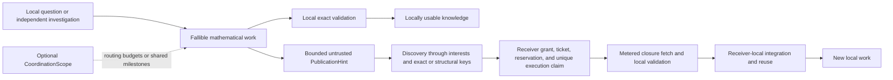

# CP-001A: Autonomous research, trustworthy reuse, and optional coordination

| Field | Value |
|---|---|
| Checkpoint | `CP-001A` |
| Date | 2026-08-27 |
| Status | Current concept amendment |
| Amends | Campaign- and root-goal-dependent language in `CP-001` |
| Preserves | Receiver-local validation, grounded signed support, exact context binding, claim-backed metered demand admission, bounded repair, and operational authorization |
| User decision | Shared root goals are optional; independent work and learning from earlier artifacts are the default |
| Priority correction | Producing or reusing useful mathematics efficiently and accepting it reliably is primary; coordination is an enabling mechanism whose marginal benefit and overhead must be measured |
| Non-claim | No implementation, mathematical-acceleration result, million-agent deployment result, or universal usefulness measure exists yet |

## 1. Decision record

The protocol must admit an execution in which:

1. no global goal, campaign, sponsor, shared budget, or common stopping rule exists;
2. agents choose unrelated local questions and may work without asking the network for permission;
3. agents publish typed artifacts or compact availability hints using resources they control;
4. later agents discover earlier work through overlapping interests, exact keys, structural indexes, or bounded semantic search;
5. every receiver decides whether an artifact deserves fetching, checking, retention, indexing, replication, or attention;
6. mathematical reuse depends on receiver-local evidence and context, not the publisher's identity or original purpose.

Optional coordinated research programs remain useful for shared budgets, division of labor, fidelity review, or a common milestone. They are not the base protocol and need not have a distinguished root goal.

The project priority is therefore:

1. **End-to-end mathematical efficacy:** actually produce or reuse contract-valid results on nontrivial tasks within explicit resources.
2. **Reliability:** prevent invalid evidence, context mismatch, vacuous formalization, corrupted dependencies, and stale support from becoming accepted local knowledge.
3. **Reusable knowledge:** make proofs, counterexamples, partials, abstractions, and informative failures useful beyond the attempt that produced them.
4. **Efficient discovery and execution:** reduce redundant work, validation cost, transfer, delay, and search waste.
5. **Optional cooperation and coordination:** measure whether passive sharing, routing, decomposition, portfolios, and shared programs improve the preceding outcomes after their overhead is charged.
6. **Availability, scale, and graceful partition behavior.**
7. **Operational authorization and resource control where required.**
8. **Political attribution, credit, prestige, ownership, and priority history.**

## 2. Primary system property

DTMKN's P0 property is **reliable useful-work efficiency**, represented as a vector rather than a global scalar.

For receiver \(i\), let \(\mathcal T_i\) be its local stream of exact task contracts, \(K_i(t)\) its locally usable knowledge at time \(t\), \(u_{i,q}\) its participant-visible local priority, and \(B_i\) its multidimensional resource ceiling. Define the receiver-local analysis

\[
Y_i^{\mathrm{local}}(T)=
\sum_{q\in\mathcal T_i}
u_{i,q}\,
\mathbf 1[
\operatorname{Stable}_i(
\operatorname{RelianceQueryOf}(q);A_i(T),O_i(T))
\land \operatorname{DescendantCost}_i(q)\preceq B_{i,q}],
\]

where \(u_{i,q}\) is local policy, not a network-wide value, currency, or consensus input. An external evaluation harness uses distinct hidden observer weights \(w_q\), which are never exposed to live nodes or substituted for \(u_{i,q}\). Report at least:

\[
\left(
Y_i^{\mathrm{local}},\;
\text{invalid automatic acceptances},\;
\text{semantic-intent bypasses},\;
\text{resource vector},\;
\text{latency},\;
\text{reuse gain},\;
\text{coordination gain or loss}
\right).
\]

An evaluation harness may aggregate these receiver-local outcomes after execution. The aggregation is an experimental observation, not a protocol utility function.

Coordination is evaluated only under identical local solvers, task releases, fault traces, and componentwise arm-wide resource ceilings. A yield-superiority claim requires

\[
\Delta_{\mathrm{coord}}
=
Y^{\mathrm{obs}}(\text{active coordination})
-Y^{\mathrm{obs}}(\text{passive typed reuse})
>0
\]

with its preregistered adjusted interval excluding zero. A resource-Pareto claim instead requires yield and reliability noninferiority within frozen margins, no resource component worse beyond its margin, and at least one strictly favorable resource interval. A reliability/resilience claim uses its separately frozen endpoint family plus yield/resource noninferiority. These labels are not interchangeable, all direct overhead categories are reported, and there is no assumption that any claim passes.

## 3. Base protocol



The research plane is open-ended and fallible. The acceptance plane is narrow and fail-closed. The optional coordination plane may influence which work is attempted or funded; it cannot make evidence valid.

### 3.1 Local research kernel

The project cannot infer mathematical efficacy from networking. Before federation, one cell must implement this bounded loop:

1. **Specify:** create an exact formal task contract and, when relevant, a separate semantic-intent parent.
2. **Retrieve:** search exact local artifacts, dependency/symbol indexes, verified relations, prior counterexamples, partials, and scoped failures.
3. **Plan:** generate a small diverse portfolio of direct proof, lemma decomposition, premise search, computation, model finding, or formalization actions.
4. **Execute:** run selected actions with exact inputs, tool versions, seeds, and resource ceilings; checkpoint only through safe typed data.
5. **Criticize:** test assumptions, quantifier order, vacuity, missing cases, context mismatch, forbidden axioms, and likely common-mode failures.
6. **Validate:** replay proofs or check certificates locally; distinguish `ACCEPT`, `REJECT`, `UNKNOWN`, and `ERROR`.
7. **Integrate:** add only contract-valid signed justifications to grounded support; publish useful typed partials and remaining obligations separately.
8. **Repair:** on a checked defect, fail closed immediately, preserve unaffected alternatives, and traverse impact under a bounded cursor.
9. **Stop or continue:** apply a local budget and stopping policy; resource exhaustion is not mathematical refutation.

Planner, retriever, solver, formalizer, critic, checker, and integrator are roles, not required identities. One agent may perform several roles, or multiple agents may supply diverse attempts. Every role output except the narrow checker result remains untrusted.

The local efficiency hypothesis is componentwise. Let \(\mathbf C_i\) contain model tokens, CPU, accelerator, checker, memory, retained bytes, wall time, and operator review. The testbed reports stable task yield together with \(\mathbf C_i\) and Pareto dominance; it does not collapse unlike resources into a hidden universal price vector. Exact action caching, validated premise reuse, explicit residual obligations, and bounded strategy portfolios are hypotheses about reducing \(\mathbf C_i\), not truth rules.

### 3.2 Passive reuse before active coordination

Once the local kernel works, the next intervention is passive typed reuse only: publish bounded hints, discover through subscriptions, import under receiver demand, replay locally, and retain exact closures. Remote task delegation, shared decomposition, leases, work stealing, and shared programs are withheld. This establishes whether earlier independent work is useful before coordination is added as a separate treatment.

## 4. Minimum object correction

```text
GoalTemplate {
  kind
  exactQuestionOrJudgment
  semanticIntentRef?
  inputRefs[]
  hardConstraints[]
  acceptableOutputTypes[]
  evidenceContract
  fidelityContract?
  acceptanceProcedure
}

RelianceQuery {
  requiredSignedJudgment
  exactContextID
  evidenceContract
  fidelityContract?
  acceptanceProcedure
}

WorkItem {
  goalTemplateID
  coordinationScopeRef?       // absent for autonomous work
  parentWorkItemCIDs[]
  dependencyWorkItemCIDs[]
  requestedServiceHints[]     // advisory only
}

WorkAdmissionRecord {
  workItemCID
  receiverCell
  issuerEpoch
  admissionScopeID: ReceiverLocalID
  budgetGrantID: ReceiverLocalID
  serviceClassID: ReceiverLocalID
  localPriorityClass
  replicationPolicy
  retentionPolicy
}

CoordinationScope {
  scopeID
  previousVersion?
  focusGoalRefs[]             // optional and unordered; may be empty
  sharedPolicyRefs[]
  reviewerAuthorities[]
  routingHints[]
  sharedBudgetPolicy?
  stoppingRule?
}

PublicationHint {
  hintID
  objectCID
  objectKind
  exactStatementOrGoalKey?
  contextID?
  closureCommitment?
  discoveryKeys[]             // bounded
  providerRecords[]           // bounded and advisory
  coordinationScopeRef?
  expiry
}

InterestSubscription {
  subscriptionID: ReceiverLocalID
  receiverCell
  issuerEpoch
  authority: HOLDER(subjectKey) | LOCAL_POLICY(policyRef)
  exactKeys[]
  structuralPredicates[]
  discoveryShards[]
  acceptedObjectKinds[]
  maximumHintRate
  expiry
}

BudgetGrant {
  budgetGrantID: ReceiverLocalID
  issuerCell
  issuerEpoch
  parentBudgetGrantID?: ReceiverLocalID
  holderOrLocalPolicy: HOLDER(subjectKey) | LOCAL_POLICY(policyRef)
  admittedServiceClassIDs[]: ReceiverLocalID
  admittedScopeIDs[]: ReceiverLocalID
  totalCeilingVector
  totalRedemptionAllowance
  ticketIssueLimit
  childGrantLimit
  expiry
}

DemandOffer {
  offerID
  receiverCell
  admissionScopeID: ReceiverLocalID
  serviceClassID: ReceiverLocalID
  routingKey
  candidatePredicateRef
  contractRef
  artifactKinds[]
  lanePolicy
  coordinationScopeRef?       // routing hint only
  expiry
}

DemandTicket {
  ticketID: ReceiverLocalID
  issuerCell
  issuerEpoch
  parentTicketID?: ReceiverLocalID
  budgetGrantID: ReceiverLocalID
  authorizationPrincipal: HOLDER(subjectKey) | LOCAL_POLICY(policyRef)
  audience: HOLDER(subjectKey) | PUBLIC_GATEWAY(laneID)
  admissionScopeID: ReceiverLocalID
  serviceClassID: ReceiverLocalID
  candidatePredicateRef
  contractRef
  artifactKinds[]
  totalCeilingVector
  perRedemptionCeilingVector
  maxRedemptions
  childTicketFanoutLimit
  expiry
}

ExecutionPrincipal =
    HOLDER(subjectKey)
  | LOCAL_EXECUTOR(executorID)
  | GATEWAY_SESSION(laneID, subjectKey)

DemandReservation {
  reservationID: ReceiverLocalID
  ticketID
  redemptionActionID
  requestDigest
  candidateCID
  reservedVector
  reservationExpiry
}

DemandExecutionClaim {
  reservationID: ReceiverLocalID
  ticketID
  redemptionActionID
  executionActionID
  claimDigest
  executionPrincipal: ExecutionPrincipal
  meterRecordID
  claimedAt
  executionExpiry
}

DemandSettlement {
  reservationID: ReceiverLocalID
  ticketID
  redemptionActionID
  requestDigest
  candidateCID
  executionActionID?
  executionPrincipal?: ExecutionPrincipal
  finalizationDigest
  terminalResultDigest?
  meterRecordDigest?
  measurementBasisByComponent:
    ResourceComponent -> NONE_UNCLAIMED | AUTHORITATIVE_METER | CONSERVATIVE_UPPER_BOUND
  outcome
  validationSpentVector
  promotion: NONE | PROMOTED(admissionDecisionID)
  promotionSpentVector
  totalSpentVector
  releasedVector
}

EvaluationSuite {             // harness-only; never transported to live nodes
  suiteID
  onlineTaskContractCIDs[]
  receiverAssignments[]
  releaseTimesAndDeadlines[]
  workloadInstanceCIDs[]
  profileDefinitions[]
  featureFlags[]
  resourceCeilings[]
  snapshotSelectionRule
  sealedFutureInputCID
  weights[]
  perTaskBudgets[]
  priorArtifactBlindAssignment
  priorArtifactFilteringPoint
  interferenceBlockRule
  inferenceScope
  noninferiorityMargins[]
  directOverheadCategories[]
  capabilityFloorThreshold
  evaluatorCID
  analysisCID
  sealAndRevealPolicy
  treatmentBlindPolicy
}
```

A `PublicationHint` says that an object may exist at named providers. A `DemandOffer` says that a receiver may consider spending bounded resources on a matching object. Neither is spendable. A receiver-issued `DemandReservation` followed by exactly one atomic `DemandExecutionClaim` remains mandatory before expensive fetch, validation, or promotion.

`ReceiverLocalID` abbreviates the issuer-qualified tuple `(issuerCell, issuerEpoch, localID)`. `reservationID` is the canonical tagged `(ticketID, redemptionActionID)` receiver-local identifier. Portable `WorkItem` fields are non-authoritative. Scheduling and resource decisions live in the receiver-authenticated `WorkAdmissionRecord`, so a foreign item cannot import its sender's priority, budget, or queue share. Root grants and root tickets require canonical absent parent tags; child transitions bind the exact parent ID. A root ticket becomes usable only after its full vector ceiling, redemption allowance, and nonreclaimable subtree issue allowance are atomically allocated from its live grant; autonomous local checking follows the same grant-to-ticket path. Grants and tickets have irreversible `ACTIVE | TERMINAL` allocation state, reservations have `RESERVED -> RUNNING(executionID, principal, meterID) -> FINALIZED` state, and only exact recorded action replay survives terminalization.

`EvaluationSuite` is documentation for the external harness, not a Cooperation Core wire object. Live nodes receive ordinary local tasks and visible budgets only; benchmark membership, observer weights, treatment labels, contrasts, and analysis remain outside their APIs and traces.

Mathematical artifacts and signed justifications may exist without a `WorkItem`. `CoordinationScope` is absent-by-tag in the mathematical identity unless an exact semantic-intent contract explicitly names a scoped reviewer.

## 5. Required invariants

### A1. Autonomous admissibility

For every object type that permits `coordinationScopeRef?`,

\[
\operatorname{coordinationScopeRef}(x)=\bot
\]

is schema-valid. Absence of a shared program cannot itself cause mathematical rejection.

### A2. Coordination non-authority

Except for an exact fidelity contract that explicitly names a reviewer scope,

\[
\operatorname{coordinationScopeRef}
\notin
\operatorname{inputs}(
\operatorname{JudgmentKey},
\operatorname{GoalKey},
\operatorname{NativeCheck},
\operatorname{StableSupport}).
\]

Joining, leaving, renaming, or deleting a coordination scope cannot change native proof validity.

### A3. Query-relative trustworthy reuse

For a receiver-local `RelianceQuery` \(q=(s,x,c,f,a)\), where \(s\) is the required signed judgment, \(x\) the exact context, \(c\) the evidence contract, \(f\) the absent-by-tag or exact fidelity contract, and \(a\) the acceptance procedure,

\[
\operatorname{Stable}_i(q;A_i,O_i)
\iff
\exists T:
\begin{aligned}[t]
&\operatorname{root}(T)=s
\land\operatorname{FiniteActiveTree}_{P_i}(T)\\
&\land\operatorname{CheckContract}_{P_i}(c,f,a,T)=\texttt{ACCEPT}
\land\operatorname{ExactContextMatch}(x,T)\\
&\land\operatorname{ClosureAvailable}(T,O_i).
\end{aligned}
\]

The root of \(T\) is an evidence-tree conclusion, not a network goal.

### A4. Hint noninterference

Before receiver selection and reservation, a publication hint may change only bounded hint caches, telemetry, advisory ranking, and quota-charged nonamplifying dissemination of the bounded frame through matching subscription/home shards:

\[
\Delta\operatorname{PublicationHint}
\not\Rightarrow
\Delta A_i
\lor\Delta U_{P_i}^{\mathrm{strict}}
\lor\Delta\operatorname{ProtectedCache}_i
\lor\Delta\operatorname{StableReliance}_i.
\]

### A5. Demand before receiver expense

\[
\operatorname{FetchClosure}_i(c)
\lor\operatorname{Validate}_i(c)
\lor\operatorname{Promote}_i(c)
\Rightarrow
\exists! \rho,x,h:
\operatorname{RunningExecution}_i(\rho,x,h)
\land\operatorname{candidateCID}(\rho)=c.
\]

A cell checking its own autonomous work issues a local grant, atomically allocates a local ticket from that grant, reserves through the ticket, and atomically claims one receiver-metered execution; no sponsor is required and Core v0 has no grant-direct paid path.

### A6. Issuer-local resource conservation

\[
\operatorname{spent}[d]
+\operatorname{outstandingReservations}[d]
+\operatorname{reservedChildren}[d]
\preceq\operatorname{ceiling}[d].
\]

In addition, for every grant \(g\),

\[
\operatorname{finalizedSpend}[g]
+\operatorname{reservedTicketCeilings}[g]
+\operatorname{reservedChildGrantCeilings}[g]
\preceq\operatorname{totalCeiling}[g],
\]

with the analogous bound for finalized redemptions plus ticket/child-grant redemption allowances. The additional monotone bounds are

\[
\operatorname{consumedTicketIssueAllowance}[g]
\leq\operatorname{ticketIssueLimit}[g],
\quad
\operatorname{consumedGrantFanout}[g]
\leq\operatorname{childGrantLimit}[g],
\quad
\operatorname{consumedTicketFanout}[d]
\leq\operatorname{childTicketFanoutLimit}[d].
\]

Root-ticket issuance requires a live grant, `parentTicketID = NONE`, and nonreclaimably consumes \(1+\texttt{childTicketFanoutLimit}\) ticket-issue units. Root grants likewise require `parentBudgetGrantID = NONE`. Child-grant and child-ticket transitions bind their exact parent IDs. Child-grant issuance consumes its declared ticket-issue allowance and \(1+\) its descendant grant-fanout allowance from its parent without later reclamation. Normative child-ticket issuance requires a live parent; identical issuer, epoch, and grant; authorized and holder/audience-attenuated delegation; same or receiver-approved attenuated admission scope/service class; artifact-kind inclusion; mechanically checked child-predicate implication; equal or approved stricter contract; no later expiry; positive redemption allowance; sufficient parent resource/redemption balance; and sufficient nonreclaimable descendant-ticket fanout. It atomically reserves the child's work allocation and consumes \(1+\) its fanout allowance before visibility.

Ticket issuance is idempotent. Terminal reclamation writes an irreversible tombstone, moves actual use to the parent ledger, releases only unused resource/redemption allocation, and never reclaims object-issue/fanout authority. A child-ticket terminal transition removes the child's full reserved ceiling/allowance from its parent ticket while adding the child's actual spend/consumed redemptions to that parent. A child-grant terminal transition identically removes the child's full resource/redemption reservation from its parent grant while adding the child's complete finalized spend/redemptions; no-live-descendant and digest-first idempotence guards are mandatory. Consequently neither sibling roots, nonzero-spend nested grants, nor repeated zero-work child tickets/grants can recycle, amplify, or oversubscribe one ancestor authority, and a fresh action cannot resurrect released capacity. Each reservation atomically reserves one of the ticket's `maxRedemptions` slots together with its vector; even unclaimed cancellation consumes that slot.

Capabilities are permission/fanout authority only with respect to mathematical work. They carry no independent work-resource vector; their only storage allowance is finite authorization-ledger bookkeeping charged to a separate bounded receiver control reserve. Every root capability preallocates a finite nonreclaimable fresh-action-record allowance. Each fresh accepted capability mutation atomically consumes one unit; rejected IDs create no durable per-ID record. Child capability issuance binds the exact parent and reserves both \(1+\) its delegated fanout and \(1+\) its complete action-record allowance without reclamation, so root allowances bound the whole capability and replay-record subtree. Every protected resource action binds the exact unique `RUNNING` reservation, execution action ID, and authenticated principal. `ClaimReservation` atomically changes `RESERVED` to `RUNNING`, creates one receiver-controlled cumulative meter/hard envelope, and admits at most one paid execution; a conflicting claim fails.

One atomic local-authority finalization derives each spend component from an authoritative meter or its frozen conservative gap bound, then records the terminal result, optional promotion, released balance, durable retained-byte allocation, in-transaction local metadata, nonauthorizing outbox intents, and immutable settlement. Claimant-reported use cannot release capacity and promotion cannot be added afterward. Actual external storage/index/replication/notification effects run only through separate ticket/reservation/claim/finalization paths. A hung claim has a receiver-bounded expiry in crash-safe `ReceiverTime(writerTimeEpoch, monotonicTick)`; writer activation durably advances the time epoch and recovery-finalizes old running claims before new protected work. It finalizes `UNKNOWN` with receiver-authoritative plus conservative-gap charges and never returns to `RESERVED`.

Ordinary autonomous operation claims issuer-local bounds. Optional shared budgets require prepartitioned disjoint escrow or narrow consensus over only that spend state.

### A7. Receiver-owned fairness

\[
\operatorname{serviceClass}(r)\in\operatorname{AdmittedClasses}_i.
\]

A sender-created goal, namespace, identity, topic, or coordination scope cannot mint a new positive-share queue. Unclassified autonomous traffic enters a bounded aggregate onboarding or exploration class.

### A8. Rootless work graphs, grounded evidence

The work graph may contain many disconnected components and no distinguished research root. Ordinary workflow cycles remain rejected or become explicit fixed-point tasks. Evidence support still requires finite grounded trees; rootless research does not license circular proof.

### A9. Evaluation separation

Harness-only `EvaluationSuite` metadata observes sealed snapshots and is excluded from live validity, admission, and participant-visible state. Let \(S_{\mathrm{probe}}\) contain sealed future held-out queries and their release policy; these become ordinary participant inputs only when released and are not observer metadata. For visible execution \(E\), fixed sealed future inputs \(S_{\mathrm{probe}}\), observer metadata \(M,M'\), and protocol projection \(\pi_{\mathrm{protocol}}\):

\[
\pi_{\mathrm{protocol}}(\operatorname{Run}(E,S_{\mathrm{probe}},M))
=
\pi_{\mathrm{protocol}}(\operatorname{Run}(E,S_{\mathrm{probe}},M')).
\]

This equality is required when visible inputs, faults, and random tapes are identical. Frozen targets prevent metric gaming in a particular experiment; they do not govern the network.

### A10. Independent-purpose reuse

If artifact \(x\), its closure, and a support tree satisfy receiver \(j\)'s exact query contract, then the absence or difference of the producer's original `WorkItem` or `CoordinationScope` cannot by itself block reuse. Purpose metadata is a discovery hint, not evidence.

### A11. Retention before reliance

A downstream stable justification may refer to a remote artifact only after the receiver has admitted an availability/retention arrangement sufficient for the required closure. Content addressing establishes integrity, not continued availability.

### A12. Conditional liveness

A standalone admitted work item with positive receiver-assigned service share eventually receives another attempt only if compatible workers are reachable infinitely often, jobs and bursts satisfy the declared envelope, and messages are eventually delivered. A persistently advertised artifact is discoverable only relative to subscribed shards or a declared bounded lookup horizon. No arbitrary publication is guaranteed checking, storage, or attention.

### A13. Reliance-cache linearizability

Every event that can change the grounded signed set, strict active set, path block, contract result, or closure availability publishes the new state, conservative dirty seeds, and next monotone reliance epoch at one linearization point. If the storage substrate cannot commit that tuple atomically, a durable in-progress epoch forces affected queries to `STALE`/`UNKNOWN` until a second epoch advance completes or recovery dirties the partition. An older cached `ACCEPT` may be returned only after the exact finite evidence tree is rechecked under one current epoch snapshot and the epoch is re-read unchanged immediately before response. Thus admitting an exact opposite-polarity proof/counterexample makes the next old-cache query return non-`ACCEPT` immediately, while a clean alternative remains usable after its own current tree is checked.

## 6. Required zero-scope execution trace

The implementation must pass this trace with every `coordinationScopeRef` absent:

1. cell \(A\) creates a local exact task, its `WorkAdmissionRecord`, and a local budget grant;
2. an agent produces a partial lemma and a Lean proof candidate;
3. \(A\) atomically issues a local demand ticket from the grant, reserves through that ticket, claims one metered execution, replays the proof, and uses one local-authority finalization to charge authoritative work, durable local retention, and admission of the exact justification;
4. \(A\) publishes a bounded `PublicationHint`; any external replication required by its availability policy runs through a separate funded execution;
5. unrelated cell \(B\) later creates a different local task;
6. \(B\)'s authenticated subscription overlaps one bounded discovery key, and quota-charged home-shard dissemination delivers only the bounded hint frame;
7. the hint changes only \(B\)'s expendable discovery state;
8. \(B\) decides the object may satisfy a requested dependency, creates its own local grant if needed, and atomically issues its own demand ticket from that grant;
9. \(B\) atomically reserves, claims one receiver-metered execution, fetches CID-valid bytes, resolves the closure, and replays the evidence;
10. \(B\) admits a new local justification under its own contract;
11. the imported lemma closes or accelerates \(B\)'s task through a finite accepted support tree;
12. all work, validation, communication, storage, and failed lookup costs are charged to the respective issuer-local grants.

This trace is the minimum demonstration of decentralized learning from earlier independent work.

## 7. Security properties in priority order

1. **Exact acceptance safety:** no automatic stable reliance without a receiver-local `RelianceQuery` and finite contract-valid evidence tree; a producer work item is optional.
2. **Semantic-fidelity separation:** a proof of a formal statement cannot close an informal intent unless the separate fidelity contract is satisfied.
3. **Grounding and conflict safety:** cycles do not self-certify; exact support/refutation conflict is not silently reusable in the strict profile; clean alternatives survive.
4. **Untrusted-publication containment:** hints and unsolicited candidates cannot alter stable state or consume protected resources beyond bounded ingress, matching hint-relay, and exploration ceilings.
5. **Resource conservation:** replay, sibling tickets, concurrent execution claims, exact child-ticket/child-grant spend roll-up, attenuated descendant creation, zero-work cancellation, crash-safe expiry, crash recovery, and partitions cannot exceed an issuer's grant or any ticket ancestor; terminal allocations cannot be resurrected, issue/fanout/action-record authority is nonreclaimable, permission capabilities cannot mint mathematical-work resources, claimant reports cannot replace per-component authoritative/conservative accounting, and promotion atomically settles only local-authority state while external effects require separate funded executions.
6. **Context-safe reuse:** exact theory, assumptions, dependencies, checker profile, and contract remain visible across reuse.
7. **Fail-closed correction:** every potentially reliance-changing event, its dirty seeds, and its next epoch publish at one linearization point or remain fail-closed in progress; admitted defects or opposing evidence immediately block stale affected reuse while bounded lazy repair preserves unaffected support.
8. **Availability honesty:** missing closures and provider failures yield explicit `UNKNOWN`, never acceptance.
9. **Operational authorization:** identity is required only where control, budgets, cell membership, revocation, reviewer scope, or measured failure domains depend on it.
10. **Discovery and scheduling non-authority:** rankings, popularity, remote signatures, program membership, and scheduler scores never enter mathematical acceptance.

## 8. Principal risks

| Risk | Why it is difficult | Required response |
|---|---|---|
| Base agents do not solve useful tasks | A perfect network cannot compensate for ineffective mathematical workers | Establish a local no-network efficacy baseline first; publish negative results |
| Wrong or vacuous formalization | Kernel validity is conditional on the encoded statement | Separate semantic-intent parents, adversarial fidelity fixtures, and scoped review |
| Context mismatch during reuse | Similar statements may differ in assumptions, universes, coercions, or libraries | Exact context keys, certified relations, target-side replay, and visible side obligations |
| Valid-junk and hint spam | Infinitely many correct but useless artifacts exist | Bounded hint caches, TTLs, receiver demand, local utility, and promotion-only spending |
| Hierarchical budget/object reuse | Ticket-local bounds do not stop sibling oversubscription, child-capacity recycling, terminal resurrection, or infinite zero-work child tombstones | Atomic full work allocation; nonreclaimable grant/ticket subtree issue allowances; normative attenuation; irreversible tombstones; terminal charging into parents; model-checked crash/replay histories |
| Multiple execution of one reservation | Two validators can concurrently start under one still-unsettled reservation | Atomic `RESERVED -> RUNNING(executionID, principal, meterID) -> FINALIZED`; every protected action binds the unique running claim |
| Meter underreporting | A claimant can report zero after consuming the reservation and recycle released budget | Receiver-controlled cumulative meter/hard envelope; authoritative equality or conservative crash charge; no release from an untrusted report |
| Mixed meter integrity | Some resource components may be measured while others have gaps | Per-component basis map; authoritative charges remain where sound and each gap takes its frozen conservative upper bound |
| Double resource authority | A permission capability with its own spend vector can double a grant-backed ticket | Permission-only capabilities; every protected action binds exactly one running metered execution |
| Capability replay-record flood | One valid capability can submit indefinitely many fresh non-metered action IDs | Finite nonreclaimable root/subtree action-record allowance; atomic per-action debit; no per-ID record for rejection |
| Split settlement/promotion | Releasing a reservation before promotion lets another action consume the same capacity | One immutable local-authority finalization records terminal outcome, per-component spend, release, durable local retention, metadata, and optional outbox intents |
| Cross-store pseudo-atomicity | A database cannot atomically commit remote replication or an unrelated filesystem/index | Inert pre-verdict staging; authoritative local reference commit; nonauthorizing outbox; distinct funded execution for every external effect |
| Clock reset extends work | A reboot may reset a monotonic clock and keep a hung claim live indefinitely | Durable writer-time epoch; expire old deadlines and recovery-finalize old running claims before new work |
| Stale acceptance after opposing evidence | A fact can become visible after an epoch bump, leaving a stale result labeled current | Atomically publish fact, dirty seeds, and epoch, or expose a fail-closed in-progress epoch; recheck exact trees under the current epoch |
| Attestation/replay mix-and-match | A forbidden-footprint proof can be paired with an unrelated clean attestation | Apply policy to receiver-replayed footprints; exact proof/result/checker/environment/policy/footprint and signature-authority binding |
| Discovery misses useful prior work | Exact search has low recall; semantic search is poisonable | Layered retrieval, typed candidate relations, hard negatives, multiple paths, and measured miss probability |
| Correlated errors | Many agents may share one model, corpus, formalization, or checker bug | Receiver-observed failure-domain evidence and seeded common-mode tests |
| Disappearing publishers | CIDs do not retain data | Explicit receiver-funded closure retention and multi-provider availability policies |
| Coordination overhead exceeds gain | Routing, decomposition, messages, and duplicate checking may cost more than they save | Compare active coordination with passive typed reuse under identical budgets |
| Sender-created fairness classes | Cheap namespaces or programs can manufacture service shares | Receiver-owned finite service classes and aggregate onboarding quotas |
| Benchmark contamination | Agents or schedulers may optimize to exposed targets | Sealed snapshots, hidden held-out queries, frozen evaluators, and preregistered analyses |
| Experimental interference/confounding | Reused artifacts, queues, budgets, faults, stronger solvers, or extra program resources can invalidate a nominal treatment contrast | Equal local solvers/arm ceilings, consumer-side blind assignment, connected-component blocks, and explicit inference scope |
| Scale claims outrun evidence | A simulator may reproduce its assumptions rather than a WAN | Calibrate on held-out real traces and label \(10^6\) as a stretch complexity run |

## 9. Technology reuse decision

| Mechanism | Decision | Narrow role |
|---|---|---|
| Lean 4 native proof replay | NOW | Primary exact formal-evidence relation |
| Small domain certificate checkers | NOW where used | Cheap local checking for SAT/computation subdomains |
| Typed canonical encoding and content addressing | NOW | Exact object, context, closure, and deduplication identity |
| Local transactional ledger | NOW | Atomic root/child grant and ticket allocation; nonreclaimable issue and finite capability control-record allowances; reservation claim, per-component meter settlement, local finalization/retention, and nonauthorizing outbox intents; terminal tombstones, crash-safe receiver time, atomic reliance publication, and recovery |
| ATMS/Datalog-style fixed-point ideas | NOW, custom profile | Grounded signed support, conflict, alternatives, and dependency repair |
| Sandboxed processes/Wasm/microVM tiers | NOW | Bound hostile parsers, builds, agents, checkers, and checkpoints |
| TLS, signatures, proof of possession, attenuable capabilities | NOW | Permission, roles, bounded nonreclaimable fanout, and finite control-record allowance; mathematical-work authority remains exclusively in grant/ticket/reservation/claim/meter ledgers |
| Structural indexes, scoped pub/sub, summaries, rendezvous hashing | NOW in the test federation | Bounded discovery and routing over object, goal, and interest keys |
| Receiver-owned finite service classes, admission bounds, backpressure, protected validation capacity | NOW, P0 contract | Resource safety and conditional queue liveness under admitted load |
| Particular pull, WFQ/DRR, work-stealing, and lease algorithms | EVALUATE | Alternative execution mechanisms; compare cost, yield, and tail behavior without changing the P0 resource contract |
| Multi-agent planner/critic/retriever/checker roles | EXPERIMENTAL P0 | Strategy diversity and decomposition; all reports remain untrusted |
| TLA+/PlusCal or equivalent, Lean lemmas, property tests, fuzzing | NOW | State-machine, fixed-point, ledger, and hostile-input assurance |
| SNARK/STARK/zkVM wrapper | LATER | Only after a frozen relation and measured repeated-verification break-even |
| Public blockchain/BFT ledger | REJECT as truth; LATER for narrow state | Possible publication accountability or truly shared spend state only |
| Public DHT, global ANN, learned scheduling | LATER | Only after measured discovery or routing bottlenecks and separate abuse models |
| Token incentives and global reputation | REJECT-P0 | Neither truth nor usefulness follows from stake, popularity, or identity count |

SNARKs do not solve the primary problem. They may reduce repeated validation cost after native evidence works. Core v0 strict P0 accepts exactly receiver-local native replay and locally checked domain certificates; succinct arguments require a later versioned policy after break-even, setup/key-to-relation, TCB, and soundness gates. Verifier acceptance implies an encoded existential relation only up to the selected system's declared negligible computational-soundness error and TCB; knowledge soundness is separately required for witness-possession claims. It does not establish that a native checker executed, faithful formalization, usefulness, data availability, or a correct verifier relation. Without an available native artifact closure, the result is `OPAQUE_RELIANCE` and cannot satisfy the strict P0/public reusable-knowledge contract.

## 10. Deliverable and staged falsification

Build **DTMKN Reliable Mathematical Research and Reuse Testbed v0** with separable layers:

1. **Local research/validation kernel:** exact tasks, a fixed local planner/decomposer/critic and bounded strategy portfolio, attempts, partials, counterexamples, Lean replay, fidelity checks, grounded support, and repair. It must operate with one cell and no shared program.
2. **Local reusable knowledge and resource-safety layer:** exact/structural retrieval, action caches, typed failures, dependency tracking, retained closures, receiver-owned finite service classes, protected validation capacity, and grant-to-ticket-to-unique-metered-execution accounting.
3. **Autonomous federation layer:** publication hints, overlapping subscriptions, receiver-funded import, independent re-admission, and cross-cell reuse with zero coordination scopes.
4. **Optional coordination layer:** remote work-item routing, publication/adoption of remote decompositions, remote capability offers, cross-cell leases, work stealing, remote portfolio orchestration, and optional `CoordinationScope`. It does not strengthen the local solver.
5. **Evaluation and scale harness:** deterministic faults, baselines, ablations, sealed held-out reuse, five real logical cells, and trace-calibrated simulation.

The mandatory comparison ladder is:

| Profile | Same frozen local solver | Exact validation | Typed memory | Cross-cell passive reuse | Remote coordination | Coordination scope |
|---|---:|---:|---:|---:|---:|---:|
| Isolated capable agent | yes | yes | no | no | no | no |
| Local typed workspace | yes | yes | yes | no | no | no |
| Raw shared store | yes | local | untyped | yes | no | no |
| Federated passive reuse | yes | yes | yes | yes | no | no |
| Federated passive reuse—prior-artifact blind | yes | yes | yes | filtered by preregistered consumer assignment | no | no |
| Federated active coordination | yes | yes | yes | yes | yes | no |
| Optional coordinated programs | yes | yes | yes | yes | yes | yes |
| Central typed service | yes | yes | yes | yes | centralized | optional matched mode |

Report these contrasts separately:

- base efficacy and reliability for every profile;
- local memory gain: local typed workspace minus isolated;
- cross-cell reuse gain: federated passive reuse minus local typed workspace and its paired prior-artifact-blind arm;
- typed-infrastructure gain: federated passive reuse minus raw shared store;
- coordination marginal effect: federated active coordination minus federated passive reuse;
- optional-program marginal effect: optional coordinated programs minus federated active coordination under the same componentwise arm-wide resource ceiling;
- decentralization overhead/resilience: federated profiles versus the central typed service.

No theorem-count metric is primary. Confirmatory task sets, release times, deadlines, weights, budgets, sealed future queries, blind-treatment assignment, interference-compatible block rule, inference scope, noninferiority margins, evaluator, overhead categories, and analysis are frozen only in a harness-side `EvaluationSuite` that is never exposed to live nodes. A complete seed replicate contains every profile trajectory needed by its estimand. Fixed-suite two-arm inference resamples whole replicates and computes paired within-seed contrasts; isolated-capability and per-profile queue gates use the corresponding one-profile statistic from each complete replicate. Workload-population inference first aggregates the relevant within-instance statistic over seeds and then resamples whole independent instances; connected workloads remain one interference block and tasks are never resampled. A negative local-efficacy result blocks claims about the network. A negative coordination or optional-program marginal effect rejects or narrows that mechanism, not the entire research/validation core.

The concept-phase deliverable consists of the Markdown specification, security model, technology map, test plan, decision ledger, source trace, audits, and a hash manifest. The implementation-phase deliverable adds canonical schemas, conformance vectors, a reference testbed, Lean workload, protocol models, raw traces, and reproducible analysis.

## 11. CP-002 entry conditions

Before an executable checkpoint is frozen:

1. define canonical wire encodings for `WorkItem`, `CoordinationScope`, `PublicationHint`, `InterestSubscription`, all demand objects, and evidence trees, plus a separate harness-only evaluation-suite format that is never transported to live nodes;
2. model the zero-scope trace, permission/resource separation, nonreclaimable root/attenuated-child issue authority and finite capability control records, `RESERVED -> RUNNING -> FINALIZED` execution claims, per-component receiver-authoritative/conservative metering, unclaimed cancellation, inert staging, local promotion/finalization plus nonauthorizing outbox intents, separately funded external effects, crash-safe time, atomic reliance publication, and irreversible issuer-ledger terminal transitions;
3. prove declarative grounded-support properties and test an executable reference evaluator against them;
4. pin a Lean/Mathlib environment and demonstrate nontrivial local task closure before federation work;
5. construct staggered autonomous task streams with genuine cross-cell reuse opportunities and hard nonmatches;
6. freeze resource accounting for every profile, including coordination messages and failed discovery;
7. preregister separate reliability, reuse, coordination, and overhead claims;
8. retain optional programs, SNARKs, blockchain, public membership, global discovery, incentives, and political attribution outside the minimum acceptance path unless a measured requirement changes this checkpoint.

## 12. Checkpoint conclusion

DTMKN is first a system for **doing and safely reusing mathematics**. It is not defined by a common mission, a campaign hierarchy, a coordination protocol, or a ledger. Autonomous work is valid and useful on its own; network cooperation emerges when local interests overlap. Coordination is retained only to the extent that it improves verified mathematical outcomes or reduces their total cost.
