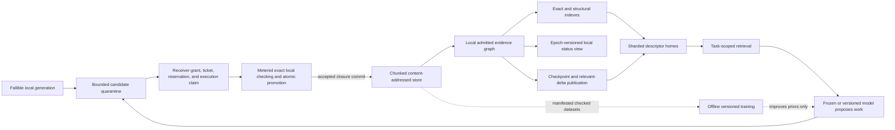

# CP-001B: Distributed exact memory, indexed discovery, and frontier-relative status

| Field | Value |
|---|---|
| Checkpoint | `CP-001B` |
| Date | 2026-08-28 |
| Status | Audited concept amendment; two independent PASS verdicts on the final substantive revision |
| Relationship | Additive to `CP-001A`; constrains the future executable `CP-002`; the frozen `CP-001A` corpus is not modified |
| Primary question | Must all theorems be stored as one corpus, or should agents learn them through continual training? |
| Decision | Use a sharded, replicated, content-addressed external corpus as exact memory; use model weights only as fallible, versioned search and generation priors |
| Priority | Efficient production and trustworthy reuse of useful mathematics; coordination is supporting infrastructure |
| Non-claim | This checkpoint does not satisfy the executable `CP-002` entry conditions, nor claim a complete global index, bounded global update delay under partitions, permanent retention of every valid object, or that online learning improves theorem yield |

## 1. Decision in one paragraph

The network does **not** need one physical machine, blockchain, model, or institution that stores the whole corpus, and no ordinary node should be required to copy every theorem. It does need exact external representations of whatever knowledge it promises can later be recovered and reused. Those representations may be sharded, deduplicated, replicated, erasure-coded, archived, or retained as exact recomputation recipes. The network-wide corpus is therefore a **virtual union** of independently retained immutable objects. Agents learn about the small, current, task-relevant part of that union through exact and structural indexes, interest subscriptions, compact checkpoint frontiers, and bounded semantic retrieval. Continual model training is complementary: it may improve tactic choice, premise ranking, conjecturing, translation, and compression of stable patterns, but it is not an exact theorem store, a freshness mechanism, or evidence of validity.

The architectural rule is:

> External checked memory provides exact identity, addressability, correction, availability evidence, and replay. Model weights provide lossy compression and fallible heuristics.

## 2. Scope and terminology

Let \(I\) be the set of independently operated cells visible under some declared observation scope. For cell \(i\) at time \(t\), let:

- \(O_i(t)\) be the immutable objects whose bytes are locally available;
- \(A_i(t)\) be its locally admitted evidence, defect, override, and availability facts; authoritative status is a derived view, not a stored assertion;
- \(P_i(t)\) be its local acceptance, reliance, retention, and freshness policy;
- \(\theta_i^v\) be its versioned model parameters;
- \(D_i(t)\) be its derived discovery indexes and provider records.

The logical published corpus is

\[
\mathcal C_I(t)=\bigcup_{i\in I}\operatorname{Published}_i(t).
\]

This definition does not imply that any node materializes \(\mathcal C_I(t)\), that every published object remains available, or that the scope \(I\) includes private, disconnected, unknown, or withholding cells. For a declared storage, failure, repair, time, and budget assumption profile \(\Phi\), the durably recoverable corpus is

\[
\mathcal R_{I,\Phi}(t)=\{c\in\mathcal C_I(t):
\operatorname{Recoverable}_{\Phi}(c,t)\}.
\]

`Recoverable` is therefore not an absolute network predicate. It means reconstructible under \(\Phi\). Receiver \(i\)'s current ability to obtain the object is a separate predicate \(\operatorname{Retrievable}_{i,\Phi}(c,t)\), which may be false during a partition even when the durability objective still holds.

For strict reuse, the relevant unit is not merely a theorem statement. It is an exact typed package containing or referring to:

- the signed judgment or exact goal;
- the formal context and environment root;
- the proof, certificate, counterexample, or other native evidence;
- its transitive dependency closure or an exact resolvable manifest;
- the checker and acceptance-procedure version;
- any semantic-fidelity contract needed to connect a formal statement to an intended informal claim.

The word *theorem* below abbreviates this richer object only when the context is unambiguous.

## 3. Why the two proposed approaches are not substitutes

### 3.1 Indexed external knowledge

External knowledge can provide:

- exact content identifiers;
- enumeration within a declared snapshot or shard;
- exact assumptions and dependencies;
- deterministic local replay;
- explicit challenges, conflicts, and availability state;
- local deletion from active reliance without pretending history disappeared;
- targeted reverse-dependency analysis;
- independent mirrors, exports, and checker implementations.

It has real storage, indexing, transfer, validation, repair, and governance costs. Those costs must be bounded by admission and retention policies.

### 3.2 Continual training

Model training can compress recurring patterns and improve:

- mathematical language and representation priors;
- tactic and premise selection;
- decomposition and proof-plan generation;
- translation and informal-to-formal proposal generation;
- retrieval ranking and query reformulation;
- recognition of frequently useful abstractions.

It cannot provide a dependable operation of the form “enumerate every exact theorem currently known, with its exact context, dependencies, counterevidence, and current availability.” It also lacks a reliable exact per-theorem delete or correction operation. A model may recall a retracted statement after attempted unlearning, fail to recall a valid theorem that affected its weights, or blend incompatible environments.

The safe authority boundary reuses CP-001A's existing reliance predicate:

\[
\operatorname{Accept}_i(q,e)
\Rightarrow
\operatorname{Stable}_{P_i(e)}
\bigl(q;A_i(e),O_i(e)\bigr).
\]

`Stable` retains the frozen requirements: a finite active signed evidence tree, exact root judgment and context, a full evidence/fidelity/acceptance-contract check, no active blocking or exact opposite-polarity defect under the strict policy, and an available exact closure. This note does not replace that predicate with a one-candidate checker call.

The model \(\theta_i^v\) may select or generate candidate objects or trees, but it does not occur as an epistemic premise in this implication. A statement recalled from weights has candidate status, exactly like an untrusted remote submission.

### 3.3 Comparison

| Requirement | External corpus and index | Continual model training |
|---|---|---|
| Exact statement and environment identity | Directly addressable by CID | Not guaranteed |
| Exact proof/dependency retrieval | Direct when retained | Not guaranteed or enumerable |
| Immediate publication path | Descriptor can be visible after publish/index delay | Requires data collection, training, evaluation, and rollout |
| Precise correction or withdrawal | Admit an immutable correction, override, defect, or availability fact and recompute the derived local reliance view | Exact erasure from weights is generally unavailable |
| Audit and replay | Native checker can replay exact bytes | Behavior is statistical and checkpoint-dependent |
| Search/generalization | Needs indexes and ranking | Often strong and useful |
| Poisoning containment | Candidates can remain quarantined until checked | Poisoned data or gradients can alter many behaviors |
| Heterogeneous foundations | Exact environment can be named | Training may silently blend them |
| Current network status | Can be stated relative to checkpoints/frontiers | Weights are necessarily lagging and opaque |
| Best role | Canonical exact memory | Proposal, ranking, and compression |

The appropriate design is therefore retrieval-first and hybrid, not training-only and not universal replication.

## 4. Impossibility boundaries and lower bounds

### 4.1 Exact information must exist somewhere if exact recovery is promised

Suppose the retained class can be in any of \(2^{U(t)}\) distinguishable corpus states and an exact decoder must reconstruct the selected state from the aggregate retained representation. The encoding must then be injective over those states, so its worst-case length is at least

\[
\Omega(U(t))
\]

bits, whether represented as native objects, coded fragments, or exact recomputation inputs and programs. Deduplication and compression can reduce representation redundancy. They cannot eliminate the information needed to distinguish every possible retained state. Training a model is another compression scheme; unless it is itself an exact decodable representation with the required interface and evidence—and ordinary LLMs are not—it does not discharge the retention requirement.

Therefore the system must choose, per object, among:

1. paying to retain exact recoverable content;
2. paying to retain an exact bounded recomputation recipe;
3. allowing the object to become unavailable.

There is no fourth option that preserves exact recoverability for free.

Bounded storage also cannot guarantee retention of every result that an adversarial future task might find useful. If capacity retains at most \(K\) of \(K+1\) distinct nonrecomputable objects, at least one must be discarded; a later task can be chosen to require exactly that object. Retention must therefore be an explicit service objective under a workload and value model, not a universal future-usefulness guarantee.

### 4.2 Instantaneous global awareness is impossible under partitions

Consider two executions as observed by cell \(i\):

- \(E_0\): no remote counterexample was published;
- \(E_1\): a remote counterexample was published, but every message carrying it is delayed by a partition.

Until a message crosses the partition, \(i\)'s local histories are identical in \(E_0\) and \(E_1\). Hence \(i\) cannot distinguish them. It cannot both remain available and truthfully guarantee awareness of every newly published opposing result.

Consequently DTMKN must not promise “every agent always knows the current status of all mathematics.” It can promise local status as of an explicit observation frontier and conditional convergence after communication resumes.

### 4.3 A complete moving “latest” snapshot cannot be certified without a boundary

In an open network with continuous publication, a complete latest global state cannot be certified or observed unless the protocol first fixes:

- a membership or shard scope;
- a checkpoint from each included authority;
- a completion/barrier rule;
- a treatment of unavailable or Byzantine members.

A distributed-snapshot protocol or causally closed barrier can construct a historical consistent cut for a fixed roster. Consensus over an arbitrary checkpoint vector establishes agreement on that vector, not causal consistency. Either mechanism adds latency and may sacrifice availability; neither is necessary for ordinary theorem retrieval.

### 4.4 A universal semantic-completeness index is unavailable

An authenticated exact index can support a statement such as “this normalized key is absent from this frozen shard snapshot” only when the snapshot protocol certifies a complete enumeration for that exact key schema. An ordinary live advisory index cannot prove even shard-local absence. No index can generally establish “no equivalent or useful theorem exists anywhere,” especially across heterogeneous logics, encodings, private corpora, and informal mathematics. Similarity search is incomplete by construction; in expressive formal systems, many equivalence and implication questions are themselves undecidable or computationally infeasible.

### 4.5 Content identity is not availability

A CID, ledger entry, Merkle inclusion proof, signature, or SNARK may establish a statement about bytes or a computation. None proves that a retrievable copy of the full dependency closure currently exists. Availability requires storage contracts, audits, repair, and reachable providers.

## 5. The required “whole-system update” property

The correct property is **frontier-relative, query-relative trustworthy awareness with conditional eventual discovery**.

### 5.1 Receiver-local status

For an exact unsigned context-bound judgment \(x\), Core v0 already defines the raw grounded evidence state

\[
\operatorname{state}_{P_i(t)}(x)
=
\left(
\mathbf 1[(\textsf{SUPPORTS},x)\in K_{P_i(t)}],
\mathbf 1[(\textsf{REFUTES},x)\in K_{P_i(t)}]
\right).
\]

Here \(K_P\) is the frozen raw grounded signed least fixed point. Its interpretation is:

| Pair | Evidence state |
|---|---|
| \((1,0)\) | supported under this exact local policy and available admitted evidence |
| \((0,1)\) | refuted under this exact local policy and available admitted evidence |
| \((1,1)\) | disputed; both grounded polarities exist |
| \((0,0)\) | unknown under the available admitted evidence |

For an exact `RelianceQuery` \(q\) requiring one signed polarity of \(x\), strict acceptance remains \(\operatorname{Stable}_{P_i(t)}(q;A_i(t),O_i(t))\). Raw evidence polarity, strict reliance, individual checker outcomes, closure availability, and observation freshness are orthogonal; they must not be flattened into one verdict. Conceptually,

\[
\operatorname{Status}_i(x,q,t)=
(\text{raw evidence},\text{strict reliance},\text{validation},
\text{availability},\text{freshness/coverage}).
\]

A proposition may be raw-supported while the requested strict contract is not accepted, current through one shard frontier but incomplete for another, or associated with an errored validation attempt without being refuted. These dimensions are receiver-local and do not claim that every cell agrees.

### 5.2 Observation frontiers

For a named authenticated shard configuration \(\mu\), a bounded task-relevant observation frontier is a map

\[
F_i=
\left(
\mu,
\{(\textit{shardID},\textit{predicateCID},
\textit{checkpointCID},\textit{cursor})\}
\right).
\]

Each `ShardCheckpoint` binds at least the membership epoch, shard configuration, log/shard ID, exact key-schema version, monotone sequence, previous checkpoint CID, Merkle root, signing authority epoch, and signature. The receiver accepts a frontier advance only after verifying the checkpoint chain or consistency proof, detecting no sequence gap, reconciling the declared buckets/range, applying the matching committed events atomically, and advancing its subscription cursor in the same local transaction.

Saying that receiver \(i\) is processed through \(F_i\) means:

> Receiver \(i\) has processed every **committed record in the mechanically enumerable coverage** selected by the exact key-schema and subscription predicate through each verified checkpoint named in \(F_i\).

It does not prove that an authority published every fact it knew, that semantic relevance is complete, that later records do not exist, that cells or shards outside the declared scope were observed, or that referenced payloads remain available. Heuristic or learned discovery always reports incomplete coverage. Gaps, rollback, equivocation, unknown schemas, or unsafe reconfiguration force the affected coverage to `INCOMPLETE` or `STALE` until repaired.

A status response should therefore contain at least:

```text
StatusResponse {
  queryCID
  unsignedJudgmentCID
  receiverCell
  policyRoot
  checkerAndEnvironmentRoots[]
  relianceEpoch
  localSnapshotID
  evaluatedAtReceiverTime
  freshnessBasis:
      SEQUENCE_WATERMARK(requiredVector)
    | RECEIVER_CHALLENGE(nonce, issuedAtReceiverTime)
    | AUTHENTICATED_CLOCK(clockProfileCID, errorBound)
  observedScopedCheckpointVector
  checkpointObservationPage { boundedRecords[], snapshotBoundNextCursor? }
  mechanicallyEnumerableCoverage
  heuristicCoverage: INCOMPLETE
  rawEvidenceState: NEITHER | SUPPORT_ONLY | REFUTE_ONLY | BOTH
  strictReliance:
      ACCEPT(activeTreeCID)
    | NOT_ACCEPTED(reason)
    | UNKNOWN(reason)
  selectedValidation {
    exactValidationKey
    assessmentCID?
    outcome: UNCHECKED | ACCEPT | REJECT | UNKNOWN(reason) | ERROR(reason)
  }
  validationAssessmentPage { boundedCIDs[], snapshotBoundNextCursor? }
  supportTreePage { boundedCIDs[], snapshotBoundNextCursor? }
  refutationTreePage { boundedCIDs[], snapshotBoundNextCursor? }
  availabilityByReturnedTree[]
  freshness:
      CURRENT_AT_SCOPED_VECTOR
    | STALE(reason)
    | INCOMPLETE(reason)
  boundedProviderObservationPage
  uncertaintyReasons[]
}
```

Every top-level field is read from one local snapshot. Every page cursor binds `localSnapshotID` and `relianceEpoch`; an expired snapshot cannot be silently continued under a newer epoch. Emitting `ACCEPT` still requires the final unchanged-epoch reread from Core v0.

For a high-criticality query, local policy may require a minimum sequence/checkpoint vector, a checkpoint response bound to a fresh receiver nonce, an authenticated-clock profile with an explicit error bound, or a named archive availability class. Receiver receipt time is recorded but does not make a replayed old checkpoint globally fresh. Without a challenge or declared trusted clock/synchrony basis, freshness is sequence-relative only; an unavailable required watermark yields `INCOMPLETE` or `UNKNOWN`. If the requirement cannot be met, strict reliance is `UNKNOWN(INCOMPLETE_FRONTIER)` or not accepted, while the separate freshness or availability fields explain why. No field is repurposed to mean another.

### 5.3 Conditional convergence

The protocol may claim:

> Fix an authenticated shard configuration, or require a safe handoff that transfers every committed descriptor and cursor. If a descriptor remains retained and advertised; at least one selected home is correct, non-omitting, fair, and eventually receives and serves it; a correct integrity-valid set of providers or \(k\) erasure fragments remains reconstructible and responsive; messages are eventually delivered; the receiver's mechanically enumerable subscription matches; the fetch/check work is bounded; the receiver gives the service class positive fair share; admitted load remains inside its declared envelope (or strong fairness is assumed); and the checker terminates, then the receiver eventually learns the candidate, can retrieve its closure, and computes its own local status.

This is an eventual delivery and evaluation result, not a bounded-delay result. A finite latency bound additionally requires declared synchrony, admitted-load, provider, validation-time, and failure assumptions.

Three convergence claims remain distinct:

1. Immutable facts admitted by one logical authority may converge across that authority's crash-fault replicas by set union or Merkle anti-entropy.
2. Same-authority replicas with equal admitted facts, defects, overrides, availability facts and closures, canonical schemas/evaluator versions, checker results, policies, and logical freshness epoch eventually compute equal materialized views after quiescence.
3. Independently operated cells eventually discover eligible candidates under the stated assumptions, but may legitimately reach different reliance decisions.

## 6. Architecture



### 6.1 Immutable object plane

Use a chunked content-addressed store with Merkle-DAG manifests. Shared libraries, environments, definitions, and proof dependencies are stored once per exact byte representation and referenced by many theorem packages. Large closures may be transferred directly between providers rather than through index homes.

The object plane has no required global total order. Exact duplicates deduplicate; conflicting or alternative objects coexist.

### 6.2 Local evidence and status plane

Each cell independently admits evidence, evaluates exact reliance queries, and maintains reverse dependencies. Any locally admitted event that can change support, refutation, contract acceptance, or closure availability must atomically publish:

\[
(\text{changed local state},\text{conservative dirty seeds},e_i+1).
\]

If atomic publication fails, affected queries remain `STALE` or `UNKNOWN`. An older cached `ACCEPT` may be reused only after its exact active evidence tree is rechecked under the current epoch and the epoch is read unchanged immediately before the answer is emitted.

A remote challenge, retraction, or counterexample is initially a candidate signal. It becomes locally effective only after receiver-local admission. Once admitted, local invalidation is immediate and fail-closed; cross-cell propagation is eventual.

### 6.3 Discovery plane

The discovery index is derived, advisory, incomplete, and rebuildable. It should have several layers:

1. `CID -> provider records`;
2. exact signed judgment, goal, context, and environment keys;
3. symbol, type-head, normal-form, assumption, declaration-shape, and dependency-shape keys;
4. receiver-derived reverse-dependency keys for targeted local defect propagation;
5. interest and subscription shards;
6. optional embeddings or learned rankers for bounded candidate generation.

The mandatory laws are

\[
\operatorname{IndexHit}(k,c)\not\Rightarrow\operatorname{Valid}(c),
\]

and

\[
\operatorname{NoIndexHit}(k)\not\Rightarrow
\operatorname{NoSuchResult}(k).
\]

Every useful index hit resolves to an exact CID. The receiver then budgets the fetch, obtains the required closure, and checks it locally. Embedding similarity cannot establish equivalence, implication, admissibility, novelty, or theorem identity. Remote reverse-dependency or impact descriptors are bounded routing candidates only. Authoritative local dirtying uses reverse edges derived from receiver-admitted exact manifests; a remote impact list cannot directly seed invalidation.

For federation scale, use:

- rendezvous or consistent hashing to assign a small number of descriptor homes;
- bounded home replication rather than all-to-all publication;
- Merkle-bucket inventory roots and delta anti-entropy;
- Bloom filters or sketches only for routing and candidate suppression;
- explicit exploration paths to reduce eclipse risk;
- hot caches for widely used foundations;
- direct content-addressed transfer for payloads.

A Bloom filter over \(N_s\) keys with false-positive probability \(\varepsilon\) requires approximately

\[
-\frac{N_s\ln\varepsilon}{(\ln 2)^2}
\]

bits. False positives cause bounded lookups. No probabilistic summary may justify an absence or invalidity decision.

### 6.4 Checkpoint and update plane

Cells and index shards publish the chained `ShardCheckpoint` records defined in section 5.2. Applying descriptor updates requires a small executable protocol:

1. admit a bounded, typed, idempotent `DescriptorEvent`;
2. verify authority epoch, sequence, previous-checkpoint binding, signature, and schema;
3. detect gaps, duplicate or out-of-order delivery, rollback, and incompatible views;
4. reconcile the declared bucket/range with consistency or range proofs;
5. atomically apply the matching event set and advance the local `SubscriptionCursor`;
6. fail closed on gaps, equivocation, unknown schemas, or interrupted commits;
7. transfer committed descriptors and cursor coverage through an authenticated re-sharding handoff before retiring an old home.

Ordinary status responses carry a bounded `ScopedCheckpointVector` over relevant event/index shards, not one tuple per agent or cell. For optional audit snapshots across many shards, a manifest may store the canonically ordered vector and publish a Merkle-vector root

\[
R_C=H(\operatorname{MerkleVector}((j,n_j,h_j)_{j\in C})).
\]

Only \(R_C\) is constant-size; the vector or its coverage proofs are not. Without a snapshot or causal-closure protocol it is a commitment to a scoped checkpoint vector, not proof of a causally consistent distributed cut. It does not prove theorem validity, present payload availability, simultaneous freshness, or absence of omitted/uncommitted facts.

Agents should receive four kinds of update, in decreasing breadth and increasing detail:

1. small checkpoint, capacity, and incident summaries;
2. exact-key, dependency, environment, and interest-subscription deltas;
3. authenticated, dependency-matched, deduplicated, quota-bounded high-priority challenge and availability-loss notifications for objects in their active reliance closure;
4. on-demand exact objects for current tasks.

High-priority notices cannot mint queue share, trigger unmetered closure fetch, or alter reliance before local admission. Broadcasting every theorem and proof to every agent would cost at least linear work in both the number of agents and new information. It defeats the purpose of sharding. “Whole-system awareness” should mean awareness of declared shard frontiers, health, and relevant changes—not possession of every leaf.

### 6.5 Learning plane

The minimum acceptance path uses a frozen or explicitly versioned model plus current retrieval. Model updates occur on a separate path:

1. select checked artifact CIDs and useful typed failures into an immutable dataset manifest;
2. quarantine raw public submissions and exclude them from automatic training;
3. preserve exact train, evaluation, checker, code, and base-model roots;
4. train a new immutable checkpoint or adapter offline;
5. test on prospectively sealed tasks, semantic-fidelity traps, poisoning cases, and per-domain regressions;
6. canary the version, preserve the previous version, and support deterministic rollback of deployment selection;
7. treat the new model or adapter as an untrusted artifact whose outputs still require checking;
8. enforce process and API privilege separation: model and ranker processes cannot directly mutate checkers, policy, admitted facts, protected indexes, reliance epochs, grants, or retention roots.

For one successful reuse path, a stage decomposition is

\[
t_{\mathrm{reuse}}
=t_{\mathrm{publish}}+t_{\mathrm{route}}+t_{\mathrm{queue}}
+t_{\mathrm{fetch}}+t_{\mathrm{check}}+t_{\mathrm{admit}}
+t_{\mathrm{commit}}+t_{\mathrm{retry}},
\]

conditional on the path completing; partitions and overload may make it unbounded. A weight-update path decomposes as

\[
t_{\mathrm{weight}}
=t_{\mathrm{collect}}+t_{\mathrm{filter}}+t_{\mathrm{train}}
+t_{\mathrm{evaluate}}+t_{\mathrm{rollout}}.
\]

The second path is normally slower and cannot precisely retract a learned association. Fast-changing and long-tail results therefore remain external. Training is justified only when a stable recurring pattern has sufficient expected future use to amortize its training, evaluation, and rollout cost while improving checked useful yield without reliability regression.

Online local adaptation may later be tested for ranking or proposal generation. It must never update the checker, acceptance policy, or admitted evidence graph from unreviewed gradients. A learned ranker cannot control the protected incident/invalidation service, bypass quotas, eliminate a bounded ranking-independent exploration lane, or monopolize validation resources.

### 6.6 Control ledger plane

Budgets, tickets, reservations, execution claims, meters, tombstones, and retention contracts are mutable operational state. They require transactionality at the authority that owns the resource. They are not mathematical evidence and are not merged into the theorem corpus.

A global blockchain is unnecessary for theorem payloads or theorem truth. A narrow consensus or ledger is justified only if the project later introduces genuinely shared mutable state—for example, one nonpartitionable budget, exclusive namespace, or membership decision. Optional transparency logs may anchor checkpoint roots. Incompatible signed views become equivocation evidence only after gossip, witness comparison, view intersection, or cross-logging exposes both views. Transparency neither validates proofs nor provides data availability.

## 7. Retention: what should actually be stored

“Generated,” “valid,” and “permanently retained” are different predicates. AI agents can produce infinitely many correct but useless variants and tautologies. Letting correctness alone create a storage entitlement permits a valid-junk denial-of-service attack.

| Lifecycle class | Typical contents | Default policy |
|---|---|---|
| Raw output | Drafts, traces, rejected generations, private reasoning | Bounded local TTL; normally not federated |
| Candidate/quarantine | Schema-valid but unchecked packages | Count/byte quotas and bounded TTL |
| Admitted descriptor | Judgment, exact context, assessment, dependencies, conflict links | Small durable local record under policy |
| Reusable closure | Native proof/certificate and exact dependency/environment closure | Retain while advertising strict reusability |
| Replicated reusable | High-demand or important closure | Explicit replica count, failure domains, expiry, and repair objective |
| Archival/foundational | Selected durable knowledge and common environments | Funded long-term replication or erasure coding |
| Recomputable | Exact inputs, program/environment, seed, and cost bound | Label `RECOMPUTABLE`; not `AVAILABLE` until replay succeeds |
| Derived index | Exact/structural/semantic mappings | Rebuildable; may be dropped and reconstructed |
| Provider record | Location and claimed retention state | Expiring soft state; verify by fetch or audit |

Candidate public retention contracts may include:

```text
TRANSIENT(expiry)
LOCAL_PIN(expiry?)
REPLICATED(r, expiry, failureDomainPolicy, auditInterval)
ERASURE(n, k, expiry, failureDomainPolicy, auditInterval)
FOUNDATIONAL_ARCHIVE(term, repairObjective)
RECOMPUTABLE(recipeCID, environmentCID, costBound)
```

A published contract is only a candidate proposal. It creates no receiver expense or garbage-collection pin. Initial local storage authority exists only after a receiver creates a `RetentionActivation` through its grant \(\to\) ticket \(\to\) reservation \(\to\) unique execution-claim path and charges the initial retained bytes and transactional metadata. The activation may commit bounded nonauthorizing outbox intents for future audits, indexing, replication, repair, renewal, notification, or deletion; every actual later protected effect requires its own funded ticket, reservation, unique execution claim, meter, and settlement. Neither an activation nor an outbox intent grants authority for such later execution. Contract terms are immutable; activation, renewal, expiry, audit result, and failure state are receiver-local operational records.

For receiver \(i\), aggregate invariants include

\[
\sum_{r\in\operatorname{LiveRoots}_i}
\operatorname{chargedBytes}(r)
+\operatorname{reservedBytes}_i
\leq B_i^{\mathrm{retention}},
\]

with analogous finite limits for live objects, descriptors, home registrations, audit/repair work, renewals, and control records. Infinitely many individually finite foreign contracts cannot create infinitely many accepted local roots.

Stable strict reuse requires the exact active closure to be available:

\[
\operatorname{StrictReusable}_i(q,c,t)
\Rightarrow
\operatorname{ClosureAvailable}_i(c,t).
\]

Expiry or provider loss sets the relevant availability dimension to `UNAVAILABLE` and forces strict reliance to `UNKNOWN` or `NOT_ACCEPTED` when no other current available tree satisfies the query. It does not make the mathematical proposition false.

Garbage collection marks only from live receiver-admitted, grant-backed retention activations and locally authorized reliance pins under those aggregate limits. A foreign signature or contract is merely a candidate. The collector traverses complete manifests, waits through a grace epoch, and then sweeps unmarked objects. Transactional root changes, in-flight pins, crash recovery, and grace epochs prevent reference-count and fetch races. Index entries and expired provider records can be rebuilt or discarded independently.

## 8. Growth model

Let, at publication time \(s\):

- \(\lambda(s)\) be the generated-object rate;
- \(p_s(s)\) be the schema-valid fraction of generated objects;
- \(p_a(s)\) be the admitted fraction conditional on schema validity;
- \(p_r(s)\) be the payload-retention activation fraction conditional on admission;
- \(p_d(s)\) be the durable-descriptor fraction conditional on admission;
- \(u(s)\) be mean unique payload bytes after chunk deduplication;
- \(m(s)\) include mean descriptor, checkpoint, status, and tombstone metadata bytes;
- \(\rho(s)\) be payload durability overhead: \(r\) for \(r\) full replicas, or approximately \(n/k\) for an \((n,k)\) erasure code before metadata and repair;
- \(h(s)\) be descriptor-home replication;
- \(R_u(a)\) and \(R_d(a)\) be the probabilities that an activated payload and descriptor, respectively, remain live at age \(a\).

The expected durable live stock at time \(T\) is

\[
\begin{aligned}
\mathbb E[S_{\mathrm{dur}}(T)]
=\int_0^T &\lambda(s)p_s(s)p_a(s)
\Bigl[
p_r(s)R_u(T-s)\rho(s)u(s)\\
&+p_d(s)R_d(T-s)h(s)m(s)
\Bigr]\,ds.
\end{aligned}
\]

This separates payload survival from descriptor survival. For approximately stationary bounded raw and quarantine queues, Little's-law terms add

\[
S_{\mathrm{raw}}\approx\lambda b_R\tau_R,
\qquad
S_{\mathrm{quarantine}}\approx\lambda p_s b_Q\tau_Q.
\]

Bounded live repair scratch space is another stock term. Cumulative repair reads/writes and network bytes are instead reported as \(B_{\mathrm{repair}}([0,T])\) and a bandwidth rate; they are not added to durable resident storage.

Under stationary parameters, finite-lifetime tiers have bounded mean stock proportional to \(\lambda\mathbb E[L]\). Only a positive indefinitely surviving fraction produces asymptotically linear durable growth. If all admitted valid payloads survive indefinitely, \(R_u(a)=1\), so storage grows at least at their unique-information rate times \(\rho\). A viable system must control admission and activation fractions, reduce \(u\) through structural sharing and compression, choose \(\rho\) according to value and failure risk, and garbage-collect expendable classes.

Let \(N\) be physical recipient nodes and \(M_s\) the logical shard count; these are not interchangeable. Balanced placement may give mean ordinary shard stock near \(S(T)/N\), but hot foundations, adversarial keys, heterogeneous capacity, and correlated failures cause skew. Sending every admitted object to every node incurs aggregate network write rate

\[
\Omega\!\left(
N\lambda p_s p_a(u+m)
\right)
\quad\text{bytes per unit time},
\]

or that rate multiplied by \(T\) over a stationary horizon \(T\). This is the wrong scaling target.

When publication exceeds validation, indexing, dissemination, or retention capacity, the system must apply quotas, admission control, demand-funded promotion, TTL expiration, lag watermarks, and explicit overload status. It must not silently label an incomplete index or unavailable closure as complete current knowledge.

## 9. Memory-slice security and reliability requirements

These labels do not renumber the project priorities. CP-001A's P0 remains the reliable useful-work-efficiency vector, with base mathematical capability and reliability preceding claims about federation or learning. The following are gates for this memory/freshness slice.

### Inherited adversary and trusted-computing boundary

Models, publishers, remote assessments, discovery indexes, checkpoint homes, and storage providers may be faulty or Byzantine. Same-authority immutable-set convergence retains Core v0's crash-fault-only assumption; Byzantine replicas require receiver re-admission or a separately specified BFT authority. The declared local TCB contains the canonical parser/hash implementation, native validation kernel, contract/policy evaluator, reliance-epoch database, and resource/retention ledger. Model and ranker processes are outside that TCB and lack write authority to it. Permissionless membership and generic Sybil/eclipse resistance remain deferred; v0 uses the fixed authenticated cell roster.

### Cross-cutting P0 prerequisite: scoped operational identity

Where checkpoint signing, cell membership, capabilities, resource ownership, semantic-review authority, provider accountability, or failure-domain measurement depends on a principal, authenticated operational identity is mandatory. This is technical authority, not political attribution. Credit, prestige, historical priority, moral authorship, and ownership remain secondary and are not theorem-validity inputs.

### M0. Exact, context-bound, receiver-local acceptance

No index, model, signature, reputation, vote, checkpoint, or producer assertion creates mathematical acceptance. Acceptance requires the exact evidence contract, context, dependency closure, checker, and local policy.

### M1. Current-epoch fail-closed reliance

After a defect, conflict, environment revocation, or closure loss is locally admitted, no affected stale path may return `ACCEPT`. Reverse-impact repair may be lazy and bounded, but query responses fail closed until current support is established.

### M2. Efficient useful reuse

Any positive memory-slice claim must pass one named, preregistered CP-001A claim class: yield superiority; resource-Pareto/noninferiority; or reliability/resilience with its required yield/resource noninferiority gates. These labels are not interchangeable, and failure on one cannot be rescued by post-hoc switching to another. Storage, retrieval, and coordination mechanisms are not successes merely because they process messages or accumulate objects.

### M3. Bounded generation, validation, index, and retention amplification

Unsolicited valid junk, malformed closures, proof bombs, recursive manifests, hint floods, or many pseudonymous submitters cannot force unbounded receiver work. Every protected fetch, check, index insertion, durable retention, replication, or repair consumes receiver-authorized bounded resources, and aggregate live activation/count invariants hold across all contracts.

### M4. Explicit availability and recoverability

Current strict reuse requires receiver-local `ClosureAvailable` for an exact accepted tree. Recoverability under a retention profile \(\Phi\) supports advertised future reuse, but it is insufficient for current strict reliance during a partition or failed reconstruction. Replica or erasure claims name expiry, audit interval, repair policy, and independently evaluated failure domains. A provider count without failure-domain evidence is not a durability guarantee.

### M5. Index non-authority and bounded anti-eclipse behavior

Poisoned hits cannot be accepted without exact checking. Omitted hits cannot support nonexistence. Under the authenticated fixed roster, multiple homes, independent providers, local indexes, bounded exploration, and explicit incompleteness reduce censorship and eclipse risk. No permissionless anti-eclipse liveness is claimed.

### M6. Learned-component containment

Training data poisoning, backdoors, catastrophic forgetting, stale associations, benchmark leakage, federated-gradient attacks, and common-mode model errors cannot directly change admitted mathematical evidence or checker behavior. Privilege separation enforces the boundary. Model versions are evaluated, canaried, and rollable back; ranking-independent exploration and protected incident service limit suppression and resource-starvation attacks.

### M7. Correction propagation with honest uncertainty

Relevant challenges and availability losses receive authenticated, dependency-matched, deduplicated, quota-bounded priority dissemination, but they become authoritative only through local checking. During incomplete observation or partitions, the system reports the scoped checkpoint vector and uncertainty rather than claiming global currency.

## 10. Cryptographic and systems mechanisms worth reusing

### Content addressing and Merkle structures

Use domain-separated cryptographic hashes over canonical typed encodings, Merkle-DAG manifests, and chunk stores. These provide immutable identity, structural sharing, efficient inclusion proofs, and inventory reconciliation. They do not provide truth or availability by themselves.

### Proof assistants and proof-producing solvers

Use native Lean replay first, with exact environment and axiom reports. Where other foundations are included, retain their native certificates and checker roots; theory morphisms or interchange layers such as MMT-style structures are explicit mathematical objects rather than implicit conversions. SAT/SMT/computer-algebra results should prefer independently checkable certificates.

### Search and knowledge-graph systems

Reuse inverted indexes, term/type discrimination trees, unification-aware retrieval, dependency graphs, compressed posting lists, rendezvous hashing, content-addressed transfer, and local ANN indexes. Learned theorem retrieval is a candidate generator; exact accessibility and context constraints are applied before use.

### Distributed storage

Reuse replicated object stores, erasure coding, integrity scrubbing, repair queues, hot/warm/cold tiers, and portable archive manifests. Persistence is a funded service objective, not an implication of publication.

### Transparency and anti-entropy

Reuse signed Merkle checkpoints, consistency proofs, gossip/cross-checking, and Merkle-bucket anti-entropy. Same-authority immutable state can use CRDT-like set convergence under its declared fault model. Independent cells exchange candidates and re-admit them; they do not merge trust decisions.

### SNARKs and succinct proofs

A SNARK may later reduce the cost of repeatedly checking a large deterministic verifier computation. A sound statement must bind at least:

```text
(statementCID, proofOrCertificateCID, dependencyRoot,
 environmentRoot, checkerBinaryOrCircuitRoot,
 proofSystemAndVersion, securityParameter,
 verifierKeyOrSetupRoot, publicInputsAndOptions,
 policyRelevantFootprint, verifierResult,
 declaredSoundnessAndKnowledgeSoundnessAssumptions)
```

Its value is succinct verification of the specified computation under those assumptions. It does **not** establish semantic fidelity, axiom consistency, novelty, index completeness, current availability, absence of counterevidence, or correctness of a faulty checker circuit. It also introduces cryptographic, circuit/compiler, setup, and data-availability assumptions. Native replay is therefore M0; SNARKs enter only after measurement shows checker cost is a real bottleneck or privacy is required.

### Blockchains and consensus

Do not place theorem payloads or theorem-validity decisions on a general blockchain. Global total ordering, universal replication, immutable valid-junk retention, and consensus latency are contrary to the storage and partition goals. A narrow ledger may later coordinate genuinely shared scarce resources or anchor transparency roots. Even then, endpoint proof checking and external data availability remain necessary.

## 11. Principal failure modes and defenses

| Failure | Consequence | Required response |
|---|---|---|
| Valid-junk explosion | Storage and index exhaustion | Demand-funded promotion, retention classes, quotas, TTLs, utility/reuse gates |
| Malformed or huge dependency closure | Validation and transfer denial of service | Manifest limits, staged fetch, size/cost bounds, sandboxing, metered execution |
| Index poisoning | Irrelevant or malicious candidates rank highly | Candidate-only semantics, exact CID resolution, local checking, ranking audits |
| Index omission or eclipse | Useful results remain invisible | Multiple homes/providers, independent routes, exploration, explicit incomplete scope |
| Provider disappearance | Hash remains but proof cannot be reused | Expiring provider records, fetch audits, replicas/erasure, repair, `UNAVAILABLE` |
| Correlated replicas | Apparent redundancy fails together | Receiver-measured failure domains, diverse implementations/operators, repair drills |
| Hot foundational dependencies | Bandwidth and latency bottleneck | Broad caches, prepositioned environments, chunking, rate limits, stronger retention |
| Garbage-collection race | Live closure is deleted | Transactional retention roots, mark epochs, grace periods, invariant testing |
| Stale global-status claim | Agent relies despite unseen correction | Frontier-bound responses, freshness policies, fail-closed incomplete-frontier state |
| Checkpoint fork, gap, or rollback | Receiver overstates processed coverage | Chained roots, consistency/range proofs, gap detection, pinned cursors, gossip/witness comparison |
| Model poisoning/backdoor | Correlated bad proposals and wasted work | Checked manifests, sealed evals, canaries, rollback, model non-authority |
| Learned-ranker starvation | Corrections or rare useful results never receive budget | Protected incident service, receiver quotas, ranking-independent exploration, suppression metrics |
| Many finite retention proposals | Aggregate object/control-record exhaustion | Receiver-local activation authority and aggregate byte/object/action ceilings |
| Catastrophic forgetting | Previously useful behaviors regress | Per-domain noninferiority tests, old checkpoint retention, external exact memory |
| Semantically vacuous formalization | Formally valid but useless result | Separate fidelity contract, counterexamples, human/agent semantic review where needed |
| Checker or environment compromise | Invalid objects pass replay | Small TCB, exact binary roots, differential/redundant checking, incident invalidation |
| Publication outruns dissemination | Growing lag and false impression of currency | Backpressure, scoped subscriptions, watermarks, lag metrics, honest `STALE` status |

## 12. Proposed input to the future executable CP-002

After all CP-001A entry conditions pass, add **DTMKN Distributed Memory and Freshness Slice v0** to the planned five-cell testbed. This concept amendment neither implements that testbed nor satisfies CP-002 by itself.

### 12.1 Schemas

Specify canonical schemas for:

- `ArtifactManifest`;
- `RetentionContract`, `RetentionActivation`, and `RetentionRoot`;
- `ProviderRecord` and `AvailabilityAssessment`;
- `ShardConfiguration`, `IndexKeySchema`, and re-sharding handoff;
- `DescriptorEvent`, `IndexDescriptor`, and exact/structural discovery keys;
- `SubscriptionCursor`, `ShardCheckpoint`, consistency/range proofs, and equivocation evidence;
- `ObservedFrontier`, `ScopedCheckpointVector`, and optional Merkle-vector audit manifest;
- `StatusQuery` and `StatusResponse`;
- `TrainingDatasetManifest`, `ModelCheckpointManifest`, and evaluation/rollback records.

Each schema needs a canonical encoding, version/domain separator, size and fanout bounds, authorization rule, idempotence key, state transition, reason codes, and conformance vectors.

### 12.2 Prototype components

Implement:

1. a planned five-cell chunked CAS with Merkle-DAG manifests and dependency deduplication;
2. local exact, symbol/type, context, and dependency indexes complete only over a named frozen local admitted snapshot and exact key-schema version;
3. sharded descriptor homes with configurable replication, Merkle-bucket anti-entropy, and routing summaries;
4. provider advertisements, audits, repair, and at least two retention classes beyond transient storage;
5. atomic local reliance-epoch invalidation and reverse-dependency dirtying;
6. a query API that returns exact candidate CIDs, policy root, reliance epoch, observed frontier, availability, and uncertainty;
7. a retrieval adapter that supplies exact objects to one frozen model and sends every proposed result to native checking;
8. retention-root mark-and-sweep garbage collection with a grace epoch;
9. portable export and rebuild of a cell's admitted corpus and exact indexes.

Model in TLA+/TLC or an equivalent executable state-machine tool at least: checkpoint/cursor atomicity; duplicate, gap, rollback, and equivocation handling; lossless authenticated re-sharding handoff; retention activation accounting; and garbage-collection live-root/in-flight-pin safety. Publish counterexample traces and conformance histories rather than only prose invariants.

The minimum slice contains no automatic online mutation of model weights. Periodic offline adaptation is an ablation, not a dependency of the trustworthy path.

### 12.3 Experimental arms

These are nested ablations inside, and do not replace, CP-001A's mandatory isolated/local, prior-artifact-blind, raw-store, passive-typed-federation, active-coordination, optional-program, and central-typed-service comparison ladder. Every arm retains the same typed local workspace, exact checker, acceptance path, and exact model checkpoint unless the named treatment is a model update.

Within the passive typed-reuse profile, use a preregistered factorial intervention:

- external federated retrieval \(R\in\{\text{off},\text{exact/structural on}\}\);
- adaptation \(L\in\{\text{frozen},\text{periodic versioned},\text{online proposal/ranking only}\}\);
- optional semantic ranker \(S\in\{\text{off},\text{on}\}\) only when bounded candidate generation is enabled.

The minimum valid-cell matrix is:

| Cell | \(R\) | \(L\) | \(S\) | Role |
|---|---|---|---|---|
| F0 | off | frozen | off | identical local-memory/checker baseline |
| F1 | on | frozen | off | exact/structural external-memory effect |
| F2 | on | frozen | on | semantic-ranker marginal effect |
| P0 | off | periodic | off | weights-only proposal profile |
| P1 | on | periodic | off | periodic-learning hybrid |
| O0 | off | online | off | online-learning proposal profile |
| O1 | on | online | off | online-learning hybrid |

For the preregistered yield endpoint \(Y\), the primary paired simple effect is

\[
\Delta_R=Y(F1)-Y(F0).
\]

Secondary simple effects include

\[
\Delta_S=Y(F2)-Y(F1),\quad
\Delta_{P\mid R=1}=Y(P1)-Y(F1),\quad
\Delta_{O\mid R=1}=Y(O1)-Y(F1),
\]

and the corresponding weights-only effects \(Y(P0)-Y(F0)\) and \(Y(O0)-Y(F0)\). Retrieval-by-learning interactions are

\[
\Delta_{R\times P}=[Y(P1)-Y(P0)]-[Y(F1)-Y(F0)],
\]

with the analogous \(\Delta_{R\times O}\). The system-profile contrasts \(F1-P0\), \(F1-O0\), \(P1-P0\), and \(O1-O0\) directly compare external memory, learned memory, and their hybrids; they are not interpreted as isolated causal effects when more than one component differs. The confirmatory contrast family, multiplicity adjustment, inference unit, margins, and estimator are frozen before evaluation. The same arm pairs feed CP-001A's reliability and componentwise resource claim procedures; a favorable \(Y\) contrast cannot override their gates.

The \(R=\text{off}\) arms still have identical local typed memory and checking; they disable access to cross-cell prior artifacts. Pair the retrieval-on profile with CP-001A's prior-artifact-blind control, raw shared-store control, and temporal data cutoff. A weights-only proposal arm is useful for measuring recall from adaptation, but weights alone cannot satisfy the persistent exact-corpus or freshness contract. If that model emits a complete proof, the proof may become trustworthy only after ordinary external materialization, admission, and independent checking.

Freeze exact model, adapter, dataset, code, index-snapshot, checker, environment, and temporal-cutoff roots. Charge corpus/index construction, anti-entropy, repair, dataset construction, training, evaluation, rollout, rollback, inference, and storage over a declared amortization horizon. Reuse CP-001A's \(Y_i^{\mathrm{local}}\), complete-replicate inference, noninferiority margins, and separate yield-superiority, resource-Pareto, and reliability/resilience claim classes. Do not substitute a post-hoc “yield or cost improved” endpoint.

### 12.4 Fault tests

At minimum test:

- delayed publication and delayed counterexample across a partition;
- locally admitted counterevidence against a cached acceptance;
- heterogeneous policies and environments;
- index omission, poisoned hits, and home eclipse;
- checkpoint gaps, forks, rollback, and equivocation;
- duplicate/out-of-order delta delivery and atomic cursor advance;
- membership epoch change and authenticated re-sharding handoff;
- Merkle anti-entropy convergence under the declared crash-fault model;
- metadata present while every payload provider disappears;
- correlated replica failure and repair;
- hot foundational dependencies;
- garbage-collection crashes and in-flight pins;
- \(10^5\) unique valid-junk or schema-valid-junk candidates and unbounded-many individually finite retention proposals;
- generation rate above validation and index capacity;
- poisoned training manifest or adapter;
- per-domain catastrophic forgetting and rollback;
- learned-ranker correction suppression, exploration starvation, and validation-budget waste.

### 12.5 Measurements and gates

Report:

- stable checked result yield on held-out tasks;
- invalid automatic acceptances and semantic-fidelity failures;
- new-result discovery, fetch, check, and local-admission latency;
- correction and availability-loss propagation latency by frontier scope;
- stale-answer and incomplete-frontier rates;
- exact, structural, and semantic Recall@\(k\) on an exhaustively labeled finite positive pool;
- Precision@\(k\), false-candidate rate, validation cost on hard negatives, and ranking-independent exploration yield;
- bytes per admitted result, unique-byte ratio, deduplication ratio, and replication overhead;
- frontier bytes, reconciliation work/backlog, per-node index/storage skew, p99/max home load, hot-key load, repair bandwidth, and lost-object rate while varying agent count, shard count, publication rate, key skew, and partitions;
- model tokens, CPU, accelerator, checker time, bandwidth, retained bytes, and wall time;
- poisoning success, useful-candidate suppression, protected-queue share, regression rate, and rollback time.

All empirical superiority, noninferiority, reliability, and scale exit thresholds must be preregistered before the relevant runs. Reporting a metric without a frozen decision rule supports description, not a pass claim.

Required safety gates include:

1. no candidate becomes accepted solely because of an index, model, checkpoint, signature, or remote verdict;
2. after local admission of exact opposing evidence, the old cached acceptance cannot be returned as current;
3. a status response always names its receiver policy, reliance epoch, scope/frontier, availability, and uncertainty;
4. no index absence is exposed as a corpus-wide nonexistence theorem;
5. aggregate receiver-admitted, grant-backed retention activations, descriptors, repairs, and control records remain within frozen byte/object/work ceilings; individually finite foreign proposals create no authority;
6. partition tests never claim bounded global freshness without the declared synchrony assumptions;
7. learned-component rollback does not roll back or mutate the external admitted evidence corpus.

## 13. Decisions and deferred questions

### Decisions fixed by this checkpoint

1. The “global corpus” is a virtual union, not one mandatory physical database.
2. Exact external artifacts and receiver-local checks are authoritative; model weights are not.
3. Retrieval and indexing are the immediate update path; versioned training is a slower optimization path.
4. No node must receive or retain every theorem.
5. Retention is tiered, explicit, and funded; valid output has no automatic permanence entitlement.
6. Global status is receiver-, query-, policy-, scope-, frontier-, and time-relative.
7. Discovery indexes are advisory; exact CIDs and local replay terminate the trusted path.
8. General blockchains are not used for theorem payloads or truth. SNARKs are optional checker-cost/privacy optimizations after profiling.
9. Root goals remain optional. Storage and status mechanisms work for independent agents reusing unrelated earlier work.

### Questions for measurement rather than assumption

1. What retention classes and default terms preserve rare valuable work without enabling valid-junk exhaustion?
2. Which exact and structural keys maximize downstream checked proof yield per index byte and validation cost?
3. What home replication and exploration policy gives acceptable recall under partitions and eclipse attacks?
4. Which checkpoint/frontier scopes are useful without imposing a global roster?
5. When does erasure coding outperform full replication for proof closures and foundational environments?
6. Does periodic distillation improve future checked yield after training, evaluation, rollout, and regression costs?
7. Does online adaptation add value beyond external retrieval, or mainly introduce drift and common-mode risk?
8. At what checker workload, if any, do SNARKs beat native replay after prover, verifier, circuit, and audit costs?
9. How should cross-foundation structural retrieval represent theory morphisms without treating heuristic alignment as proof?

## 14. Checkpoint conclusion

DTMKN should not attempt to put the whole of mathematics into every node or continuously rewrite every agent's weights with every new result. It should maintain a selectively retained, distributed exact evidence corpus whose objects can be located through sharded indexes and whose current use is decided by receiver-local checking. Agents remain current by following compact frontiers and relevant subscriptions, retrieving exact task-relevant closures on demand, and reporting uncertainty when observation is incomplete.

The system-level objective is not universal synchronized belief. It is:

\[
\boxed{
\text{fast relevant discovery}
+\text{exact recoverability}
+\text{local replay}
+\text{honest freshness}
+\text{bounded retention}
}
\]

under explicit resource and fault assumptions. Continual learning may improve the rate at which agents find and construct useful candidates, but it remains downstream of exact stored evidence and upstream of independent verification.

## 15. Analysis trace

This checkpoint synthesizes three independently produced read-only analyses:

| Analysis | Bytes | SHA-256 |
|---|---:|---|
| [Distributed storage and indexing](../analyses/CP-001B-storage-index-report.md) | 3504 | `0a902991e9ce50e5f763056a90e62fed546fc310b713df4d6f606cb9a6afb8c5` |
| [Continual learning versus exact memory](../analyses/CP-001B-continual-learning-report.md) | 3277 | `d4bb1fdbab76406d5d481004a6a64cc515fdb413f0a0c7c57c40fa7262ed5cfe` |
| [Global-status semantics](../analyses/CP-001B-global-status-report.md) | 3493 | `48bc483ed4b939cae0f7e601b9e3e4dc3b0ef52364db40e7f5570adbffcc112f` |

The analyses agreed on the hybrid authority boundary and independently rejected both universal physical replication and weights-as-truth. Two later agents independently audited correctness and buildability. The first draft failed; findings were repaired; both auditors returned `PASS` on substantive-revision SHA-256 `3bdee2125658f65debe0128ba5640210eeb29abffcf75ee86bb4c218870d6075`.

The source conversation is `D:\Downloads\ChatGPT-AI and Mathematics Research-20260827-1346.md`, SHA-256 `82f92900ec07b78b80c99c19cdea0179450dfe0cb4ec0fb0f22fb2a4b9328922`. Frozen inputs include CP-001A SHA-256 `0934768dcd88de0771df1abea4dba9467e44799c08477641440e54418841deba` and Cooperation Core v0 SHA-256 `00c9549aa02b9272510a7948fe1a4103a026b0a566f072cd560e9eb5080a2375`.

The [CP-001B audit disposition](../audits/CP-001B-AUDIT-DISPOSITION.md) records finding dispositions, the final post-trace hash, and the unchanged frozen-manifest verification. The only edits after the double-PASS substantive hash were this status/trace section and its audit link.
